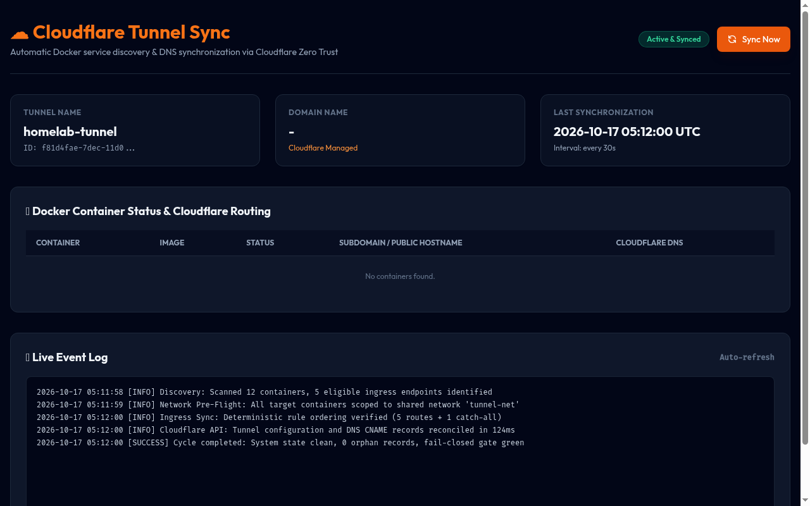
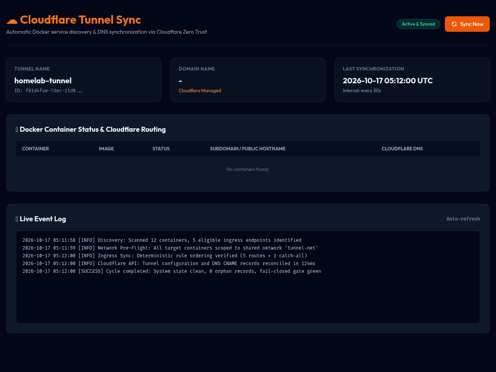
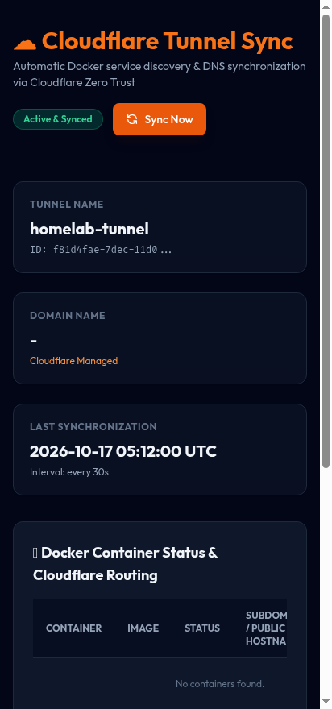

# 🚀 Cloudflare Tunnel & Docker Sync

[](https://github.com/hapheus/cf-docker-tunnel-sync/actions/workflows/ci.yml)
[](https://hub.docker.com/r/hapheus/cf-tunnel-sync)
[](https://github.com/hapheus/cf-docker-tunnel-sync/releases)
[](LICENSE)
[](https://hub.docker.com/r/hapheus/cf-tunnel-sync)
[](pyproject.toml)

Automatically sync Docker containers with Cloudflare Tunnels (Zero Trust). Just add labels to your Docker containers, and this tool handles tunnel creation, Cloudflare ingress rules, and proxied DNS CNAME records automatically.

```text
                  Internet (HTTPS Requests)
                             │
                             ▼
                  Cloudflare Edge Network
                             │
                             ▼ (Zero Trust Encrypted Tunnel)
    ┌────────────────────────┼───────────────────────────────┐
    │ Docker Host            ▼                               │
    │                 ┌─────────────┐                        │
    │                 │ cloudflared │                        │
    │                 └──────┬──────┘                        │
    │                        │                               │
    │      Docker Network:   │ cf-tunnel-net                 │
    │      ┌─────────────────┼────────────────────────┐      │
    │      ▼                 ▼                        ▼      │
    │ ┌──────────┐    ┌──────────────┐         ┌───────────┐ │
    │ │  my-app  │    │  vaultwarden │         │ (any app) │ │
    │ └──────────┘    └──────────────┘         └───────────┘ │
    │                                                        │
    │ ┌────────────────────────────────────────────────────┐ │
    │ │ cf-tunnel-sync (Central Agent & Embedded Dashboard)│ │
    │ │  • Listens to Docker socket /events (Real-time)    │ │
    │ │  • Coalescing Debouncer & Healthcheck              │ │
    │ │  • Updates Cloudflare Tunnel Ingress & DNS         │ │
    │ │  • Web UI on Port 8090 (Host: 8080) with Basic Auth│ │
    │ └──────────────────────┬─────────────────────────────┘ │
    │                        │                               │
    └────────────────────────┼───────────────────────────────┘
                             ▼
                    /var/run/docker.sock
```

---

## 📸 Screenshots & Previews

| Web Dashboard (Status & Health) | Dark Theme & Dynamic Inspection | Mobile Responsive UI |
|:---:|:---:|:---:|
|  |  |  |

---

## ✨ Features

- ⚡ **Event-Driven Docker Discovery:** Listens directly to the Docker socket stream (`/events`) for instantaneous synchronization when containers start, stop, or restart.
- 🎛️ **Coalescing Debouncer:** Buffers rapid container bursts (e.g., `docker compose up` launching multiple services) to prevent Cloudflare API rate-limiting.
- 🛡️ **Embedded Status Dashboard:** Lightweight FastAPI web UI served directly on internal port `8090` (host `8080`) with built-in HTTP Basic Auth and fail-closed security.
- 🌐 **Automated Ingress & DNS:** Automatically provisions Cloudflare Tunnel ingress configurations and proxied DNS CNAME records.
- ⏳ **Graceful DNS Tombstoning:** When containers stop, tunnel ingress rules are removed immediately, while DNS records are retained in tombstone for a grace period (default 5m) to prevent DNS flapping during container reboots or updates.
- 🔒 **Zero Inbound Ports:** Keep your firewall fully closed—traffic flows securely through Cloudflare Zero Trust Tunnels.
- 🏷️ **Clean Labeling:** Configure hostnames, internal ports, HTTPS origins, self-signed TLS verification, and path routing using clean `cf.tunnel.*` labels.
- 🏢 **Multi-Account & Multi-Tunnel Support:** Seamlessly route different containers across different Cloudflare accounts or tunnel instances on a single Docker host.
- 🩺 **Hermetic Healthchecks:** Native Python container healthcheck ensuring both the local Docker connection and Cloudflare API reachability are operational.

---

## 🔑 Step 1: Cloudflare API Token Setup

`cf-docker-tunnel-sync` requires an API Token to manage your Cloudflare Tunnels and DNS records.

1. Go to the [Cloudflare Dashboard → My Profile → API Tokens](https://dash.cloudflare.com/profile/api-tokens).
2. Click **Create Token** → Select **Create Custom Token**.
3. Name your token (e.g., `Docker-Tunnel-Sync`).
4. Configure the following **Permissions**:
   - `Zone` → `DNS` → `Edit` *(Required to create and prune CNAME records)*
   - `Zone` → `Zone` → `Read` *(Required to look up Zone IDs for your domain)*
   - `Account` → `Cloudflare Tunnel` → `Edit` *(Required to manage Tunnels, credentials, and ingress configurations)*
5. Under **Zone Resources**:
   - Include → `All zones` (or select your specific domain).
6. Under **Account Resources**:
   - Include → `All accounts` (or select your specific Cloudflare account).
7. Click **Continue to summary** → **Create Token** and save your generated token.

---

## 🛠️ Step 2: Deployment

`cf-docker-tunnel-sync` is deployed as a **central gateway stack** on your Docker host.

### 1. Configure Environment Variables
Copy `.env.example` to `.env`:
```bash
cp .env.example .env
```

Edit `.env` and fill in your details:
```env
DOMAIN_NAME=yourdomain.com
CLOUDFLARE_API_TOKEN=your_copied_api_token_here
CLOUDFLARE_TUNNEL_NAME=my-pi-tunnel

# Embedded Web Dashboard Authentication
DASHBOARD_AUTH_ENABLED=true
DASHBOARD_USERNAME=admin
DASHBOARD_PASSWORD=choose_a_strong_password

# Host Port Mapping
DASHBOARD_PORT=8080
```

### 2. Run the Central Gateway Stack
Create a `docker-compose.yml` file:

```yaml
services:
  cloudflared:
    image: cloudflare/cloudflared:latest
    restart: always
    command: tunnel --no-autoupdate --protocol ${CLOUDFLARED_PROTOCOL:-auto} run --token-file /etc/cloudflared/token
    volumes:
      - cf_token_data:/etc/cloudflared
    networks:
      - cf-tunnel-net
    extra_hosts:
      - "host.docker.internal:host-gateway"

  cf-tunnel-sync:
    image: hapheus/cf-tunnel-sync:latest
    restart: always
    environment:
      - CLOUDFLARE_API_TOKEN=${CLOUDFLARE_API_TOKEN}
      - DOMAIN_NAME=${DOMAIN_NAME}
      - CLOUDFLARE_TUNNEL_NAME=${CLOUDFLARE_TUNNEL_NAME:-cf-docker-tunnel-sync}
      - CLOUDFLARE_ACCOUNT_ID=${CLOUDFLARE_ACCOUNT_ID:-}
      - CLOUDFLARED_CONTAINER_NAME=${CLOUDFLARED_CONTAINER_NAME:-}
      - DASHBOARD_AUTH_ENABLED=${DASHBOARD_AUTH_ENABLED:-true}
      - DASHBOARD_USERNAME=${DASHBOARD_USERNAME:-${BASIC_AUTH_USERNAME:-}}
      - DASHBOARD_PASSWORD=${DASHBOARD_PASSWORD:-${BASIC_AUTH_PASSWORD:-}}
      - SYNC_FALLBACK_INTERVAL=${SYNC_FALLBACK_INTERVAL:-900}
    volumes:
      - /var/run/docker.sock:/var/run/docker.sock:ro
      - cf_token_data:/etc/cloudflared
    ports:
      - "${DASHBOARD_BIND_ADDRESS:-0.0.0.0}:${DASHBOARD_PORT:-8080}:8090"
    networks:
      - cf-tunnel-net
    healthcheck:
      test: ["CMD", "python", "healthcheck.py"]
      interval: 10s
      timeout: 5s
      retries: 3
      start_period: 5s

networks:
  cf-tunnel-net:
    name: ${CF_NETWORK_NAME:-cf-tunnel-net}
    driver: bridge

volumes:
  cf_token_data:
```

Start the central gateway:
```bash
docker compose up -d
```

### 3. Architecture & Authentication Details
- **Single-Container Architecture:** `cf-tunnel-sync` runs both the synchronization worker and the FastAPI web dashboard internally on port `8090` (mapped to host port `8080`).
- **Fail-Closed Authentication:** Basic Authentication is enabled by default (`DASHBOARD_AUTH_ENABLED=true`). If credentials are empty or not configured, access returns HTTP `401 Unauthorized` to safeguard against accidental unauthenticated exposure.
- **Headless Mode:** If you do not want the dashboard published to your host network, simply remove the `ports:` mapping from the `cf-tunnel-sync` service.

<details>
<summary><b>Optional: Legacy Standalone Nginx Dashboard Proxy</b></summary>

For legacy multi-container setups preferring a separate Nginx frontend proxy, you can unpublish port `8090` from `cf-tunnel-sync` and attach the companion `hapheus/cf-tunnel-dashboard` container:

```yaml
  cf-tunnel-dashboard:
    image: hapheus/cf-tunnel-dashboard:latest
    restart: always
    environment:
      - BASIC_AUTH_USERNAME=${DASHBOARD_USERNAME:-admin}
      - BASIC_AUTH_PASSWORD=${DASHBOARD_PASSWORD:-changeme}
      - SYNC_BACKEND_HOST=cf-tunnel-sync
      - SYNC_BACKEND_PORT=8090
    ports:
      - "${DASHBOARD_PORT:-8080}:80"
    networks:
      - cf-tunnel-net
```
</details>

---

## 🐳 Step 3: Exposing Other Containers (Multi-Compose Setup)

`cf-docker-tunnel-sync` acts as a **central gateway** for your entire Docker host (like Traefik or Nginx Proxy Manager). You do **not** run a separate `cf-docker-tunnel-sync` inside every project.

Keep your application in its own `docker-compose.yml` and attach it to the shared `cf-tunnel-net` network:

```yaml
services:
  whoami:
    image: traefik/whoami
    restart: always
    labels:
      - "cf.tunnel.hostname=whoami.yourdomain.com"
      - "cf.tunnel.port=80"
    networks:
      - cf-tunnel-net

networks:
  cf-tunnel-net:
    external: true
```

---

## 🏷️ Container Labels Reference

| Label | Description | Default / Example | Required |
|---|---|---|---|
| `cf.tunnel.hostname` | Public FQDN to expose through Cloudflare. | `app.example.com` | **Yes** |
| `cf.tunnel.port` | Internal container port to route traffic to. | See Port Discovery below | No |
| `cf.tunnel.service` | Explicit URL override (e.g. `tcp://host:22`, `http://custom:8080`). | Generated from protocol + host + port | No |
| `cf.tunnel.protocol` | Origin scheme: `http` or `https`. | `http` | No |
| `cf.tunnel.tls.verify` | Set to `false` to disable TLS certificate verification for self-signed origins. | `true` | No |
| `cf.tunnel.origin_server_name` | Hostname to validate in origin certificate (SNI override). | Hostname | No |
| `cf.tunnel.path` | Match incoming requests on a specific URL path prefix. | - | No |
| `cf.tunnel.tunnel_name` | Target a specific Cloudflare Tunnel for multi-tunnel hosts. | Value of `CLOUDFLARE_TUNNEL_NAME` | No |
| `cf.tunnel.account_id` | Target a specific Cloudflare Account ID for multi-account hosts. | Value of `CLOUDFLARE_ACCOUNT_ID` | No |
| `cf.tunnel.enabled` | Explicitly enable (`true`) or disable (`false`) syncing for this container. | `true` (if hostname present) | No |

### 🔍 Port Discovery Hierarchy
When `cf.tunnel.port` is not explicitly set, `cf-docker-tunnel-sync` determines the target origin port using the following precedence:
1. **Explicit Service URL:** If `cf.tunnel.service` is defined (e.g., `http://my-service:8080`), it takes top precedence.
2. **Explicit Port Label:** If `cf.tunnel.port` is provided (e.g., `8080`), it routes to that container port.
3. **Container Inspection:** Discovers the first exposed private port defined in container metadata (`ports[0]["PrivatePort"]` from Dockerfile `EXPOSE` or compose `expose`/`ports`).
4. **Protocol Default:** Falls back to port `443` if `cf.tunnel.protocol=https`, otherwise port `80`.

---

## 🔄 Synchronization & Lifecycle Semantics

### Event-Driven Debounce Engine
`cf-docker-tunnel-sync` maintains an open stream to `/events` on the Docker daemon socket:
- **Instantaneous Sync:** When containers start, stop, die, or restart, sync is triggered within milliseconds.
- **Coalescing Debouncer:** Multiple rapid Docker events (such as `docker compose up -d` starting 5 services) are collected over `SYNC_DEBOUNCE_SECONDS` (default `2.5s`) into a single batch sync, preventing Cloudflare API quota exhaustion.
- **Starvation Protection:** Under continuous event churn, `SYNC_DEBOUNCE_MAX_DELAY` (default `10.0s`) enforces an upper bound before a sync run is executed.
- **Fallback Heartbeat:** A periodic sync runs every `SYNC_FALLBACK_INTERVAL` (default `900s` / 15 minutes) to reconcile external Cloudflare dashboard changes or recover from missed socket events.

### DNS Grace Period & Tombstoning
To avoid DNS flapping, slow propagation, and API rate limits during brief container restarts or image upgrades:
- **Immediate Ingress Rule Updates:** When a container stops, it is immediately pruned from Cloudflare Tunnel ingress routing so traffic fails closed safely.
- **DNS CNAME Tombstoning:** The Cloudflare DNS CNAME record is retained in a tombstone state for `DNS_CLEANUP_GRACE_PERIOD` (default `300s` / 5 minutes). If the container recovers within this window, the tombstone is cleared without touching the Cloudflare DNS API.
- **Immediate Deletion:** Set `DNS_IMMEDIATE_CLEANUP=true` if your workflow requires immediate DNS record deletion upon container stop.

---

## ⚙️ Configuration Variables

### Runtime Environment Variables (`cf-tunnel-sync`)

| Variable | Description | Default | Required |
|---|---|---|---|
| `DOMAIN_NAME` | Root domain managed on Cloudflare (e.g., `example.com`). Used for automated domain scoping. | - | **Yes** |
| `CLOUDFLARE_API_TOKEN` | API Token created in Step 1. | - | **Yes** |
| `CLOUDFLARE_TUNNEL_NAME` | Name of the Cloudflare Tunnel. | `cf-docker-tunnel-sync` | No |
| `CLOUDFLARE_ACCOUNT_ID` | Cloudflare Account ID (auto-discovered from zone if omitted). | Auto-discovered | No |
| `CLOUDFLARED_CONTAINER_NAME` | Name of the companion `cloudflared` container (auto-discovered if omitted). | Auto-discovered | No |
| `DASHBOARD_AUTH_ENABLED` | Enable HTTP Basic Authentication for the embedded dashboard (`true`/`false`). | `true` | No |
| `DASHBOARD_USERNAME` | Basic Auth username. *(Alias: `BASIC_AUTH_USERNAME`)* | - | If auth enabled |
| `DASHBOARD_PASSWORD` | Basic Auth password. *(Alias: `BASIC_AUTH_PASSWORD`)* | - | If auth enabled |
| `SYNC_DEBOUNCE_SECONDS` | Debounce window in seconds to coalesce rapid Docker events. *(Alias: `SYNC_DEBOUNCE_DELAY`)* | `2.5` | No |
| `SYNC_DEBOUNCE_MAX_DELAY` | Maximum delay in seconds before forcing a sync during continuous container churn. | `10.0` | No |
| `SYNC_FALLBACK_INTERVAL` | Periodic fallback sync in seconds to heal external drift. *(Aliases: `SYNC_INTERVAL`, `POLL_INTERVAL`)* | `900` (15m) | No |
| `DNS_CLEANUP_GRACE_PERIOD` | Grace period in seconds to retain DNS records for stopped containers against flapping. | `300` (5m) | No |
| `DNS_IMMEDIATE_CLEANUP` | When set to `true`, deletes DNS records immediately without waiting for grace period. | `false` | No |
| `REQUIRE_SHARED_NETWORK` | When set to `true`, excludes containers that do not share a network with `cloudflared`. | `false` | No |
| `DOCKER_SOCKET` | Path to the Docker daemon socket. *(Alias: `DOCKER_SOCKET_PATH`)* | `/var/run/docker.sock` | No |
| `DOCKER_TIMEOUT` | Timeout in seconds for Docker socket API requests. | `10.0` | No |
| `DOCKER_RETRIES` | Number of retry attempts on Docker socket read errors. | `3` | No |
| `LOG_LEVEL` | Application logging verbosity (`DEBUG`, `INFO`, `WARNING`, `ERROR`). | `INFO` | No |

### Docker Compose Interpolation Variables (`.env`)

| Variable | Description | Default |
|---|---|---|
| `DASHBOARD_PORT` | Host port mapped to embedded dashboard internal port 8090. | `8080` |
| `DASHBOARD_BIND_ADDRESS` | Host IP interface to bind dashboard port (`0.0.0.0` for all, `127.0.0.1` for local-only). | `0.0.0.0` |
| `CF_NETWORK_NAME` | Bridge network name shared between `cloudflared` and your services. | `cf-tunnel-net` |
| `CLOUDFLARED_PROTOCOL` | `cloudflared` transport protocol (`auto`, `http2`, `quic`). | `auto` |

---

## 🛠️ Troubleshooting & Common Pitfalls

### 1. Docker Socket Permission Denied
**Symptom:** Logs show `PermissionError: [Errno 13] Permission denied: '/var/run/docker.sock'`.  
**Cause:** The user running inside the container does not have permission to read the host Docker socket.  
**Resolution:** Ensure `/var/run/docker.sock:/var/run/docker.sock:ro` is mounted in your compose file. On systems with custom Docker socket ACLs or rootless Docker, ensure the Docker socket has read access or pass `user: "${DOCKER_UID}:${DOCKER_GID}"`.

### 2. 502 Bad Gateway / Cloudflare Edge Error
**Symptom:** Browser returns HTTP 502 Bad Gateway when navigating to your public hostname.  
**Cause:** The application container is running, but `cloudflared` cannot reach it across Docker networks.  
**Resolution:** Verify your application container is attached to the shared bridge network (`cf-tunnel-net`). You can test network connectivity directly from `cloudflared`:
```bash
docker exec -it <cloudflared_container_id> ping <app_container_name>
```

### 3. Cloudflare API Token Permissions
**Symptom:** Logs show `403 Forbidden` or `Authentication error` when calling Cloudflare APIs.  
**Cause:** The API token is missing required scopes.  
**Resolution:** Ensure your token includes:
- `Zone -> DNS -> Edit`
- `Zone -> Zone -> Read`
- `Account -> Cloudflare Tunnel -> Edit`

### 4. Dashboard Returns HTTP 401 Unauthorized
**Symptom:** Visiting `http://<host-ip>:8080` prompts for credentials and rejects login.  
**Cause:** `DASHBOARD_AUTH_ENABLED=true` is set, but `DASHBOARD_USERNAME` or `DASHBOARD_PASSWORD` are blank or invalid. The service enforces a **fail-closed** policy to prevent unauthorized access.  
**Resolution:** Set valid `DASHBOARD_USERNAME` and `DASHBOARD_PASSWORD` values in your `.env` file and recreate the container:
```bash
docker compose up -d --force-recreate cf-tunnel-sync
```

### 5. Cloudflare Tunnel Protocol / QUIC Blocked
**Symptom:** `cloudflared` logs show continuous reconnect attempts or UDP connection timeouts.  
**Cause:** Some ISPs, cloud providers, or firewalls block outbound UDP port 7844 (QUIC).  
**Resolution:** Force `cloudflared` to use HTTP/2 over standard HTTPS (TCP 443) by setting:
```env
CLOUDFLARED_PROTOCOL=http2
```

---

## 🌐 Multi-Account & Multi-Domain Setups

`cf-docker-tunnel-sync` supports running multiple tunnel stacks side-by-side cleanly:

1. **Automated Domain Scoping:**  
   Each `cf-tunnel-sync` instance automatically filters discovered containers against its configured `DOMAIN_NAME`.
2. **Dedicated Tunnel Scoping:**  
   Use `cf.tunnel.tunnel_name` and `cf.tunnel.account_id` labels to direct specific containers to designated tunnels.
3. **Segregated Gateway Networks:**  
   Set different `CF_NETWORK_NAME` values (e.g. `cf-tunnel-prod` and `cf-tunnel-dev`) to keep network traffic completely isolated.

---

## 🔌 Exposing Non-Docker Host Services

To route public traffic to a service running directly on the host (e.g., Mac or Raspberry Pi host service outside Docker):

1. Ensure `extra_hosts: ["host.docker.internal:host-gateway"]` is present in your `cloudflared` service.
2. Label any dummy or companion container with:
   ```yaml
   labels:
     - "cf.tunnel.hostname=service.yourdomain.com"
     - "cf.tunnel.service=http://host.docker.internal:8000"
   ```

---

## 💝 Support the Project

If `cf-docker-tunnel-sync` saves you time and makes your self-hosting smoother, consider supporting:

- ☕ **Buy me a coffee:** Send a tip via [PayPal](http://paypal.me/hapheus).
- 🎗️ **Charity Donation:** Donate to [Österreichische Krebshilfe (Austrian Cancer Aid)](https://www.krebshilfe.net/) or any local animal welfare organization.
- 🎯 **Dream Support:** I would love tickets for the World Darts Championship at **Ally Pally** (Alexandra Palace) 😅 – hopefully, I will make it there one day!
