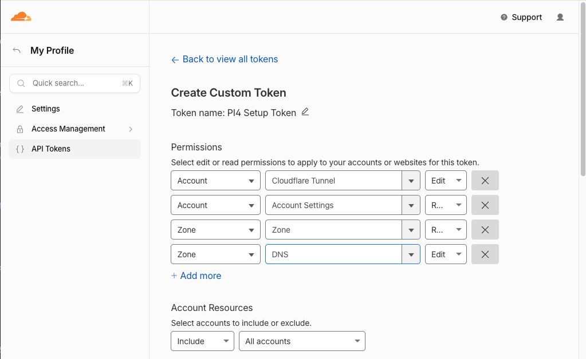

# 🚀 Cloudflare Tunnel & Docker Sync

[](https://github.com/hapheus/cf-docker-tunnel-sync/actions/workflows/ci.yml)
[](https://hub.docker.com/r/hapheus/cf-tunnel-sync)
[](https://github.com/hapheus/cf-docker-tunnel-sync/releases)
[](LICENSE)
[](pyproject.toml)

> **Expose your existing Docker Compose services through Cloudflare Tunnel — without manually configuring ingress rules or DNS records.**

---

## 🛡️ Compatibility & Security Promise

- **Zero Inbound Firewall Ports:** No port forwarding on your router (`80`, `443`, etc.), no public static IP, and no UPnP required.
- **Zero Host Port Bindings:** Origin application containers run entirely without publishing host ports (`ports:` block is optional or completely removed).
- **Non-Intrusive Integration:** Works with your existing Docker Compose setups out of the box — add two container labels and one shared bridge network.

---

## 🏗️ Architecture: Before & After

```
Traditional / Manual Setup:
Internet ---> Router (Open Port 80/443) ---> Host IP:Port ---> Container
                  ⚠️ Requires public IP, dynamic DNS, port forwarding, and manual certificates.

cf-docker-tunnel-sync Gateway Architecture:
Internet ---> Cloudflare Edge ---> [Outbound Encrypted Tunnel]
                                              |
                   +--------------------------v---------------------------+
                   | Docker Host                                          |
                   |   +----------------------------------------------+   |
                   |   | Gateway Stack (Headless)                     |   |
                   |   |   • cloudflared (tunnel connector)           |   |
                   |   |   • cf-tunnel-sync (DNS & route automation)  |   |
                   |   +----------------------+-----------------------+   |
                   |                          |                           |
                   |         Docker Bridge Network (cf-tunnel-net)        |
                   |                          |                           |
                   |   +----------------------v-----------------------+   |
                   |   | Your Existing Application Containers         |   |
                   |   |   • whoami / nextcloud / vaultwarden         |   |
                   |   |   • Zero exposed host ports                  |   |
                   |   +----------------------------------------------+   |
                   +------------------------------------------------------+
```

---

## ⚡ 3-Step Success Path

Expose any existing Compose service to the world in three simple steps.

### Step 1: Create a Scoped Cloudflare API Token

Go to **Cloudflare Dashboard → My Profile → API Tokens → Create Token → Custom Token**:

- **Permissions:**
  - `Account` → `Cloudflare Tunnel` → `Edit`
  - `Zone` → `DNS` → `Edit`
  - `Zone` → `Zone` → `Read`
- **Account Resources:** `Include` → `All accounts` (or your specific account)
- **Zone Resources:** `Include` → `All zones` (or your target domain)



> 💡 **Where do I find my Account ID?**  
> In your Cloudflare dashboard, select your domain under **Websites**, scroll down on the **Overview** page, and copy **Account ID** from the right sidebar.

---

### Step 2: Deploy the Headless Gateway Stack

Create a dedicated directory for your gateway (e.g., `~/stacks/gateway/docker-compose.yml`):

```yaml
services:
  cloudflared:
    image: cloudflare/cloudflared:latest
    container_name: cloudflared
    restart: unless-stopped
    command: tunnel run --token ${CLOUDFLARED_TUNNEL_TOKEN}
    networks:
      - cf-tunnel-net

  cf-tunnel-sync:
    image: hapheus/cf-tunnel-sync:latest
    container_name: cf-tunnel-sync
    restart: unless-stopped
    environment:
      - CLOUDFLARE_API_TOKEN=${CLOUDFLARE_API_TOKEN}
      - CLOUDFLARE_ACCOUNT_ID=${CLOUDFLARE_ACCOUNT_ID}
      - CLOUDFLARE_TUNNEL_NAME=production-gateway
      - DOMAIN_NAME=example.com
      - LOG_LEVEL=INFO
    volumes:
      - /var/run/docker.sock:/var/run/docker.sock:ro
    networks:
      - cf-tunnel-net

networks:
  cf-tunnel-net:
    name: cf-tunnel-net
    driver: bridge
```

Start the gateway:
```bash
docker compose up -d
```

---

### Step 3: Add 1 Network & 2 Labels to your Existing Service

Connect your existing container to `cf-tunnel-net` and declare the desired hostname and internal listening port.

#### Literal Before & After Compose Diff

```diff
 services:
   whoami:
     image: traefik/whoami:latest
-    ports:
-      - "8080:80"
+    networks:
+      - default
+      - cf-tunnel-net
+    labels:
+      - "cf.tunnel.hostname=whoami.example.com"
+      - "cf.tunnel.port=80"

+networks:
+  cf-tunnel-net:
+    external: true
```

> ⚠️ **Container Port vs. Host Port:**  
> `cf.tunnel.port` specifies the internal port your container listens on inside the container network (`80` in whoami's case). You no longer need to expose or publish host ports (`ports: "8080:80"`).

Restart your application service:
```bash
docker compose up -d
```

`cf-tunnel-sync` instantly detects the new container, registers the ingress rule with Cloudflare Tunnel, and provisions the `whoami.example.com` DNS CNAME record!

---

## ⏱️ 2-Minute Verification Path

Verify your deployment with this single verification sequence:

### 1. Check Container Health
```bash
docker compose ps
```
*Expected: Both `cloudflared` and `cf-tunnel-sync` report status `Up`.*

### 2. Inspect Sync Logs
```bash
docker compose logs -f cf-tunnel-sync
```
*Expected output:*
```text
INFO: ✅ [PREFLIGHT PASS] Cloudflare API Token authenticated successfully
INFO: ✅ Cloudflare Tunnel 'production-gateway' ready
INFO: 🚀 Discovered container whoami (whoami.example.com -> http://whoami:80)
INFO: ✅ Cloudflare Tunnel ingress configuration updated
INFO: ✅ Cloudflare DNS CNAME created: whoami.example.com -> <tunnel-id>.cfargotunnel.com
```

### 3. Test Public Connectivity
```bash
curl -Iv https://whoami.example.com
```
*Expected:*
```text
HTTP/2 200
server: cloudflare
cf-ray: ...
```

### Troubleshooting Quick Guide

| Symptom | Root Cause | Fix |
| :--- | :--- | :--- |
| `curl: (6) Could not resolve host` (`NXDOMAIN`) | DNS record not yet created or propagation delay. | Check `docker compose logs cf-tunnel-sync`. Ensure API token has `Zone:DNS:Edit` permission. |
| `HTTP 502 Bad Gateway` | `cloudflared` cannot reach container IP/port. | Verify target container is on `cf-tunnel-net`. Verify `cf.tunnel.port` matches the internal application port. |
| `HTTP 525 / SSL Handshake Failed` | Upstream service uses HTTPS with self-signed certificate. | Add label `cf.tunnel.origin_request.no_tls_verify=true` to your container. |
| Logs show `SAFETY_GUARD_TRIPPED` | More than 3 services stopped simultaneously. | Protective circuit breaker tripped. Set `ALLOW_MASS_DELETIONS=true` if teardown was intentional. |

---

## 🔄 Startup & Tunnel Lifecycle Truth

`cf-docker-tunnel-sync` operates in two distinct execution modes:

### 1. Non-Mutating Preflight Mode (`PREFLIGHT_ONLY=true` or `--preflight`)
- Performs **read-only** verification of Docker socket connectivity, Cloudflare API credentials, and token permissions.
- Inspects whether the specified tunnel exists in your account.
- **Guaranteed non-destructive:** Never creates or deletes tunnels, DNS records, or ingress rules. Exits immediately with code `0` on success or code `1` with actionable remediation guidance.

### 2. Standard Continuous Sync Mode (Default)
- **Automatic Tunnel Creation:** If `CLOUDFLARE_TUNNEL_NAME` is configured and the tunnel does not yet exist in your Cloudflare account, `cf-tunnel-sync` automatically creates it on first startup.
- **Existing Tunnel Re-use:** If `CLOUDFLARE_TUNNEL_ID` is provided (or if a tunnel matching `CLOUDFLARE_TUNNEL_NAME` already exists), it connects and synchronizes against the existing tunnel.
- **Event-Driven Synchronization:** Listens to the Docker event stream in real-time with an intelligent 2-second debounce filter, ensuring rapid updates during container restarts without hammering the Cloudflare API.
- **Fallback Polling:** Continuously reconciles state every 30 seconds (`SYNC_INTERVAL=30`) to recover from network disconnects or out-of-band changes.

---

## 🖥️ Built-in Web Dashboard (Optional)

`cf-tunnel-sync` includes a lightweight, real-time web dashboard for inspecting active routes, Docker container health, and live sync logs.

| Desktop Overview | Mobile Overview |
| :---: | :---: |
|  |  |

To enable HTTP Basic Authentication for the dashboard, add to your gateway environment:
```env
DASHBOARD_AUTH_ENABLED=true
DASHBOARD_USERNAME=admin
DASHBOARD_PASSWORD=your-secure-password
```

---

## 📚 Detailed Reference Documentation

- ⚙️ **[Configuration Reference](docs/configuration.md)** — Exhaustive list of all environment variables, flags, and circuit breakers.
- 🏷️ **[Docker Labels Reference](docs/labels.md)** — Comprehensive container label guide (HTTP/HTTPS, SNI, multi-domain routing, TLS settings).
- 🛡️ **[Security Architecture & Socket Hardening](docs/security.md)** — Docker socket tradeoffs, least-privilege socket proxy, and credential redaction.
- 🔄 **[Operations, Teardown & Uninstall](docs/operations.md)** — Downtime semantics, tombstoning lifecycle, and clean uninstallation runbook.
- 🏆 **[Flagship Multi-Compose Walkthrough](examples/02-multi-compose/README.md)** — Production-grade multi-stack guide with zero host-port exposure.
- 📖 **[10-Minute Canonical Quickstart](QUICKSTART.md)** — Rapid standalone walkthrough.
- 📋 **[Compatibility Baseline](docs/COMPATIBILITY.md)** — Verified Docker Compose versions and system matrix.

---

## 🤝 Contributing

We welcome contributions! Please review [CONTRIBUTING.md](CONTRIBUTING.md) for code style, hermetic testing standards, and our pull request checklist.

---

## 📄 License

This project is licensed under the [MIT License](LICENSE).

---

## 💖 Support the Project

If `cf-docker-tunnel-sync` helps power your home server or production infrastructure, consider supporting:

- ☕ **Buy me a coffee:** Send a tip via [PayPal](http://paypal.me/hapheus).
- 🎗️ **Charity Donation:** Donate to [Österreichische Krebshilfe (Austrian Cancer Aid)](https://www.krebshilfe.net/) or your local animal welfare organization.
- 🎯 **Dream Support:** Help send me to the World Darts Championship at **Ally Pally** (Alexandra Palace) 😅!
