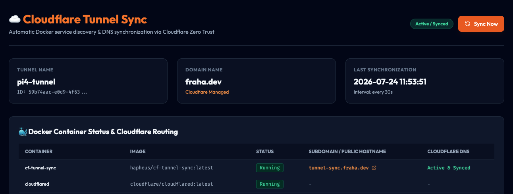

# 🚀 Cloudflare Tunnel & Docker Sync

An automated tool to dynamically expose Docker containers using a **Cloudflare Zero Trust Tunnel** and manage DNS records automatically based on container labels.

No local scripts, no cron jobs, and no complex manual tunnel setup required. Just add labels to your Docker containers, and they will be online in seconds.

> ℹ️ **Domain Requirement:** Your domain must be **managed by Cloudflare** (meaning its DNS name servers point to Cloudflare). The domain does **not** need to be registered with Cloudflare Registrar (you can buy it anywhere else, like GoDaddy, Namecheap, etc.).

---

## 📸 Screenshots & Previews

*Here are the steps and dashboard previews:*

1. **Cloudflare API Token Configuration**
   
   *(Create a custom token with specific edit rights for Zone and Cloudflare Tunnels)*

2. **Sync Dashboard Overview**
   
   *(Access your optional status page on port 8080 to monitor containers, DNS status, and sync logs)*

---

## ✨ Features

- **Automatic Service Discovery:** Scans running containers via `/var/run/docker.sock`.
- **Zero-Config Tunnels:** Automatically creates, configures, and runs a Cloudflare Tunnel using your API token.
- **Dynamic DNS Management:** Syncs CNAME records for labeled containers and cleans up obsolete ones when containers stop.
- **Separated & Optional Web Dashboard:** A lightweight dashboard running on Nginx, completely decoupled from the core sync logic.
- **Private Core API:** The unauthenticated Core API is reachable only inside the Docker network; the dashboard is its authenticated proxy.
- **Multi-Arch Support:** Docker image works on standard Linux (AMD64) and Raspberry Pi (ARM64).

---

## 🔑 Step 1: Cloudflare API Token Setup

You only need **one API token** to manage the entire lifecycle of the tunnel and DNS records.

1. Go to your **Cloudflare Dashboard** -> **My Profile** -> **API Tokens**.
2. Click **Create Token** -> scroll down to **Create Custom Token** -> click **Get Started**.
3. Set the following permissions:
   - **Account** / **Cloudflare Tunnel** / **Edit**
   - **Zone** / **Zone** / **Read**
   - **Zone** / **DNS** / **Edit**
4. Set the **Account Resources** to **Include** -> *Your Account*.
5. Set the **Zone Resources** to **Include** -> *All Zones* (or select your specific domain).
6. Click **Continue to summary** and click **Create Token**. Copy the token string.

---

## 🛠️ Step 2: Deployment

### 1. Configure Environment Variables
Copy `.env.example` to `.env`:
```bash
cp .env.example .env
```

Open `.env` and fill in your details:
```env
DOMAIN_NAME=yourdomain.com
CLOUDFLARE_API_TOKEN=your_copied_api_token_here
CLOUDFLARE_TUNNEL_NAME=my-pi-tunnel
DASHBOARD_AUTH_ENABLED=true
BASIC_AUTH_USERNAME=choose_a_username
BASIC_AUTH_PASSWORD=choose_a_long_random_password
```

### 2. Run the Central Gateway Stack
Create a `docker-compose.yml` file:

```yaml
services:
  cloudflared:
    image: cloudflare/cloudflared:latest
    restart: always
    command: tunnel --no-autoupdate run --token-file /etc/cloudflared/token
    volumes:
      - cf_token_data:/etc/cloudflared
    networks:
      - cf-tunnel-net
    extra_hosts:
      - "host.docker.internal:host-gateway"

  cf-tunnel-sync:
    image: hapheus/cf-tunnel-sync:latest
    restart: always
    environment:
      - CLOUDFLARE_API_TOKEN=${CLOUDFLARE_API_TOKEN}
      - DOMAIN_NAME=${DOMAIN_NAME}
      - CLOUDFLARE_TUNNEL_NAME=${CLOUDFLARE_TUNNEL_NAME:-cf-docker-tunnel-sync}
      - CLOUDFLARE_ACCOUNT_ID=${CLOUDFLARE_ACCOUNT_ID:-}
      - CLOUDFLARED_CONTAINER_NAME=${CLOUDFLARED_CONTAINER_NAME:-}
      - POLL_INTERVAL=30
    volumes:
      - /var/run/docker.sock:/var/run/docker.sock:ro
      - cf_token_data:/etc/cloudflared
    # Deliberately not published to the host: the API has no authentication.
    expose:
      - "8090"
    networks:
      - cf-tunnel-net
    healthcheck:
      test: ["CMD", "python", "healthcheck.py"]
      interval: 10s
      timeout: 5s
      retries: 3
      start_period: 5s

  cf-tunnel-dashboard:
    image: hapheus/cf-tunnel-dashboard:latest
    restart: always
    environment:
      - DASHBOARD_AUTH_ENABLED=${DASHBOARD_AUTH_ENABLED:-true}
      - BASIC_AUTH_USERNAME=${BASIC_AUTH_USERNAME:-}
      - BASIC_AUTH_PASSWORD=${BASIC_AUTH_PASSWORD:-}
    ports:
      - "${DASHBOARD_BIND_ADDRESS:-0.0.0.0}:${DASHBOARD_PORT:-8080}:80"
    networks:
      - cf-tunnel-net
    depends_on:
      cf-tunnel-sync:
        condition: service_healthy
    # Optional: publish the dashboard through the Cloudflare Tunnel.
    # labels:
    #   - "cf.tunnel.hostname=tunnel-sync.${DOMAIN_NAME}"
    #   - "cf.tunnel.port=80"
    healthcheck:
      test: ["CMD-SHELL", "wget --no-verbose --tries=1 --spider http://127.0.0.1/health || exit 1"]
      interval: 10s
      timeout: 5s
      retries: 3
      start_period: 2s

networks:
  cf-tunnel-net:
    name: ${CF_NETWORK_NAME:-cf-tunnel-net}
    driver: bridge

volumes:
  cf_token_data:
```
Start the containers:
```bash
docker compose up -d
```

Your Sync Dashboard is now available on your local network at `http://your-host-ip:8080`. The Core API is intentionally not exposed on a host port; it is accessible only to services in `cf-tunnel-net`.

> ℹ️ **Dashboard is Optional:** If you do not need the visual web dashboard and want to save resources or run headless, you can completely comment out or remove the `cf-tunnel-dashboard` service block from your `docker-compose.yml`. The core sync container `cf-tunnel-sync` will continue to run and sync your containers perfectly.

> ⚠️ **Dashboard Security:** Basic Authentication is enabled by default. You must set `BASIC_AUTH_USERNAME` and `BASIC_AUTH_PASSWORD`; the dashboard refuses to start without them. Never use placeholder or default credentials.

### Optional: Disable Dashboard Authentication

On a trusted, access-controlled network, you can disable dashboard authentication:

```env
DASHBOARD_AUTH_ENABLED=false
```

This makes the dashboard and its sync controls accessible to anyone who can reach its host port. Use a firewall or bind it only to the local machine with `DASHBOARD_BIND_ADDRESS=127.0.0.1` when appropriate.

### Optional: Publish the Dashboard Through the Tunnel

The dashboard is **not** published through the Cloudflare Tunnel by default. If you deliberately need remote access, add these labels to `cf-tunnel-dashboard`:

```yaml
labels:
  - "cf.tunnel.hostname=tunnel-sync.${DOMAIN_NAME}"
  - "cf.tunnel.port=80"
```

Keep authentication enabled and consider an additional Cloudflare Access policy before exposing it publicly.

---

## 🐳 Step 3: Exposing Other Containers (Multi-Compose Setup)

`cf-docker-tunnel-sync` acts as a **central gateway** for your entire Docker host (like Traefik or Nginx Proxy Manager). You do **not** run a separate `cf-docker-tunnel-sync` inside every project.

Instead, keep your application in its own `docker-compose.yml` and attach it to the central `cf-tunnel-net` network:

```yaml
services:
  my-app:
    image: nginx:alpine
    # Note: container_name is optional. Docker Compose automatically assigns unique names.
    labels:
      - "cf.tunnel.hostname=app.${DOMAIN_NAME}"
      - "cf.tunnel.port=80"
    networks:
      - cf-tunnel-net

networks:
  cf-tunnel-net:
    external: true
```

### Container Labels Reference

| Label | Description | Default / Example | Required |
|---|---|---|---|
| `cf.tunnel.hostname` | The public domain name you want to route to this container (must match configured `DOMAIN_NAME`). Protocol prefixes (e.g. `https://`) and trailing slashes are automatically sanitized. | `app.${DOMAIN_NAME}` | **Yes** |
| `cf.tunnel.port` | The internal container port (`1-65535`). If omitted, automatically defaults to `443` for HTTPS origins or `80` for HTTP origins. | `80` (or `443` for HTTPS) | No |
| `cf.tunnel.protocol` | Origin connection protocol: `http` or `https`. *(Aliases: `cf.tunnel.proto`, `cf.tunnel.scheme`)* | `http` | No |
| `cf.tunnel.tls.verify` | Whether Cloudflare Tunnel verifies upstream TLS certificates. Set to `false` for internal or self-signed certificates. *(Aliases: `cf.tunnel.notlsverify=true`, `cf.tunnel.notls_verify=true`)* | `true` | No |
| `cf.tunnel.origin_server_name` | Overrides the Server Name Indication (SNI) hostname sent to the TLS origin. *(Aliases: `cf.tunnel.originservername`, `cf.tunnel.origin.server.name`)* | `origin.internal` | No |
| `cf.tunnel.http_host_header` | Overrides the HTTP `Host` header sent to the upstream service. *(Aliases: `cf.tunnel.httphostheader`, `cf.tunnel.http.host.header`)* | `app.${DOMAIN_NAME}` | No |
| `cf.tunnel.service` | Explicit target URL (e.g. for non-Docker host services via `http://host.docker.internal:8080`). When set, overrides container name/port. | - | No |
| `cf.tunnel.name` | Explicitly binds the container to a specific tunnel name (useful for multi-tunnel setups on the same domain). | - | No |

### Example: HTTPS Origin with Self-Signed Certificate (e.g., Authentik, Vault)

If your internal service runs HTTPS with a self-signed or internal certificate, configure `cf.tunnel.protocol=https` and disable TLS verification via `cf.tunnel.tls.verify=false`:

```yaml
services:
  authentik-server:
    image: ghcr.io/goauthentik/server:latest
    restart: unless-stopped
    labels:
      - "cf.tunnel.hostname=auth.${DOMAIN_NAME}"
      - "cf.tunnel.protocol=https"
      - "cf.tunnel.port=9443"
      - "cf.tunnel.tls.verify=false"
      - "cf.tunnel.origin_server_name=auth.internal" # Optional SNI override
    networks:
      - cf-tunnel-net
```

> [!IMPORTANT]
> The target container must join `cf-tunnel-net` (`external: true`) so `cloudflared` can reach it via internal Docker DNS.

---

## 🌐 Multi-Account & Multi-Domain Setups

What if you have multiple services belonging to **different Cloudflare accounts or different domains** on the same server?

`cf-docker-tunnel-sync` supports running multiple tunnel stacks side-by-side cleanly:

1. **Automated Domain Scoping:**
   Each `cf-tunnel-sync` instance automatically filters discovered containers against its configured `DOMAIN_NAME`.
   - A tunnel configured for `company.com` will only manage `*.company.com`.
   - A tunnel configured for `personal.me` will only manage `*.personal.me`.
   They will never interfere with or overwrite each other's DNS records or ingress rules.

2. **Project & Volume Isolation:**
   Run each tunnel stack in its own directory (e.g. `/opt/tunnels/company/` and `/opt/tunnels/personal/`). Docker Compose automatically isolates named volumes and container names.

3. **Separate Networks & Ports:**
   In `.env` of your second stack:
   ```env
   DOMAIN_NAME=otherdomain.com
   CLOUDFLARE_API_TOKEN=token_for_other_account
   CLOUDFLARE_TUNNEL_NAME=other-tunnel
   CF_NETWORK_NAME=cf-tunnel-net-other
   DASHBOARD_PORT=8081
   ```
   Services intended for `otherdomain.com` then simply join `cf-tunnel-net-other` as an external network.

4. **Optional Tunnel Pinning:**
   If you run multiple tunnels for the same domain (e.g., staging vs. prod), attach the label `cf.tunnel.name=my-tunnel-name` to your application container to route it strictly through that specific tunnel.

---

## 🔌 Exposing Non-Docker Host Services (e.g., Local Mac / Pi Host Ports)

If you have a service running directly on your host machine (outside Docker) and you want to expose it through the tunnel, you can do this by using a **dummy container** as a bridge.

1. **How it works:**
   Since `cf-tunnel-sync` scans Docker containers, start a lightweight bridge container with labels pointing traffic to `host.docker.internal` using `cf.tunnel.service`.

2. **Add a Bridge Service to your Compose file:**
   ```yaml
   services:
     host-app-bridge:
       image: alpine
       command: sleep infinity
       restart: always
       labels:
         - "cf.tunnel.hostname=local-service.${DOMAIN_NAME}"
         - "cf.tunnel.service=http://host.docker.internal:8080" # Port running on your host OS
       networks:
         - cf-tunnel-net

   networks:
     cf-tunnel-net:
       external: true
   ```

*Note: The `extra_hosts` mapping `host.docker.internal:host-gateway` is already configured in the `cloudflared` compose service by default to make this work on Linux/Raspberry Pi.*

---

## ⚙️ Configuration Variables

| Variable | Description | Default | Required |
|---|---|---|---|
| `DOMAIN_NAME` | Root domain managed on Cloudflare (e.g., `example.com`). Used for automated domain scoping. | - | Yes |
| `CLOUDFLARE_API_TOKEN` | API Token created in Step 1. | - | Yes |
| `CLOUDFLARE_TUNNEL_NAME` | The name for the Cloudflare Tunnel. | `cf-docker-tunnel-sync` | No |
| `CLOUDFLARE_ACCOUNT_ID` | Cloudflare account ID; auto-detected from zone if left empty. | - | No |
| `CF_NETWORK_NAME` | Docker network name created by the stack. Useful to change for multi-stack setups. | `cf-tunnel-net` | No |
| `CLOUDFLARED_CONTAINER_NAME` | Specific name or ID of the `cloudflared` container to restart; auto-detected if empty. | - | No |
| `POLL_INTERVAL` | Docker socket scan interval in seconds. | `30` | No |
| `DASHBOARD_AUTH_ENABLED` | Enable Basic Authentication for the dashboard (`true` or `false`). | `true` | No |
| `BASIC_AUTH_USERNAME` | Dashboard username; required when authentication is enabled. | - | Conditional |
| `BASIC_AUTH_PASSWORD` | Dashboard password; required when authentication is enabled. | - | Conditional |
| `DASHBOARD_BIND_ADDRESS` | Address used for the dashboard host port; set to `127.0.0.1` for local-only access. | `0.0.0.0` | No |
| `DASHBOARD_PORT` | Dashboard host port. Change when running multiple stacks on one host. | `8080` | No |
| `SYNC_DEBOUNCE_DELAY` | Coalescing debounce window (in seconds) for Docker container lifecycle events. | `2.5` | No |
| `SYNC_FALLBACK_INTERVAL` | Periodic fallback sync heartbeat interval (in seconds). | `900` | No |
| `DOCKER_TIMEOUT` | Docker socket connect and read timeout (in seconds). | `10` | No |
| `DOCKER_RETRIES` | Max connection retries with exponential backoff on Docker socket requests. | `3` | No |
| `DNS_CLEANUP_GRACE_PERIOD` | Grace period (in seconds) to retain DNS records for stopped containers before deletion against flapping. | `300` | No |
| `DNS_IMMEDIATE_CLEANUP` | When set to `true`, immediately purges obsolete DNS records without tombstoning grace period. | `false` | No |

---


## 💝 Support the Project

If you find this project helpful, consider showing some support:

- ☕ **Buy me a coffee:** Send a tip via [PayPal](http://paypal.me/hapheus).
- 🎗️ **Charity Donation:** Donate to [Österreichische Krebshilfe (Austrian Cancer Aid)](https://www.krebshilfe.net/) or any local animal welfare organization.
- 🎯 **Dream Support:** I would love some tickets for the World Darts Championship at **Ally Pally** (Alexandra Palace) 😅 – hopefully, I will make it there one day!
