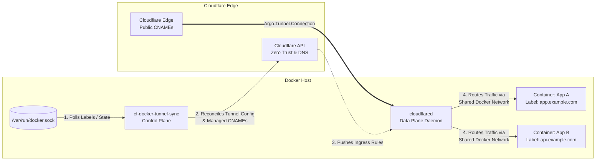

<div align="center">

# ☁️ cf-docker-tunnel-sync

### *Label. Launch. Live. Stop exposing ports. Start exposing services.*

Automated, self-healing Cloudflare Zero Trust Tunnel & DNS CNAME synchronization for Docker containers.

[](https://github.com/hapheus/cf-docker-tunnel-sync/releases)
[](https://hub.docker.com/r/hapheus/cf-tunnel-sync)
[](https://hub.docker.com/r/hapheus/cf-tunnel-sync)
[](https://github.com/hapheus/cf-docker-tunnel-sync/stargazers)
[](LICENSE)

[](https://github.com/hapheus/cf-docker-tunnel-sync/actions)
[](https://github.com/hapheus/cf-docker-tunnel-sync/actions/workflows/daily-image-verification.yml)
[](https://scorecard.dev/viewer/?uri=github.com/hapheus/cf-docker-tunnel-sync)

### [Quickstart](#quickstart) • [How It Works](#how-it-works) • [Safety & Ownership](#safety-and-ownership) • [Architecture](#architecture) • [Examples](#examples) • [Docs](docs/)

</div>

---

## 📸 Visual Proof & Control Plane

> **Zero Port Forwarding. Zero Dynamic DNS Scripting. Zero Manual Ingress Rules.**  
> Simply add `cf.tunnel.enable=true` and `cf.tunnel.hostname=app.example.com` to any Docker container. `cf-tunnel-sync` automatically creates the Cloudflare Tunnel, configures ingress routing, provisions orange-cloud proxied DNS CNAMEs, and tracks sync health in real time.

| Real-Time Status & Diagnostics | Mobile Telemetry |
| :---: | :---: |
|  |  |

---

## 🏗️ Control Plane vs. Data Plane <a id="architecture"></a><a id="control-plane-vs-data-plane"></a>

A core design principle of `cf-docker-tunnel-sync` is the strict separation between the **Control Plane** and the **Data Plane**:



* **Control Plane (`cf-tunnel-sync`):** Interrogates Docker container labels, computes changes, writes credentials to a shared volume (`/etc/cloudflared/token`), and reconciles Cloudflare Tunnels and DNS via Cloudflare's REST API. It **never proxies user traffic**.
* **Data Plane (`cloudflared`):** Official Cloudflare daemon. Reads the generated token file, maintains the encrypted tunnel connection to Cloudflare edge, and routes incoming traffic directly across Docker bridge networks into your containers.

---

## ⚙️ How It Works (The Controller Pattern) <a id="how-it-works"></a><a id="how-it-works-the-controller-pattern"></a>

Modeled after modern Kubernetes controllers, `cf-docker-tunnel-sync` operates on a deterministic, self-healing reconciliation model:

* **Zero Local State / No Database:** The daemon stores no state files or SQLite databases on disk. Running Docker containers and remote Cloudflare configurations are the single source of truth.
* **Self-Healing Reconciliation Loop:** Periodically (fallback every 30s) and immediately upon Docker container lifecycle events (with a 2.5-second debounce filter), the controller compares local desired state with remote Cloudflare state.
* **Diff-Check Before Mutations:** If no containers have started, stopped, or changed labels, **zero Cloudflare API write requests are made**, protecting you against API rate limits.
* **Autonomous Resilience:** If Cloudflare's API experiences a momentary hiccup or the server temporarily loses internet connectivity, the system automatically recovers on the very next cycle without requiring container restarts.

---

## 🛡️ Safety, DNS Ownership & Security <a id="safety-and-ownership"></a><a id="safety-dns-ownership-security"></a><a id="safety-dns-ownership--security"></a>

Installing an infrastructure daemon with Docker socket access and DNS write permissions requires absolute trust. Here is how `cf-docker-tunnel-sync` protects your infrastructure:

### 1. Will this tool delete my existing, manual DNS records?
**No. Never.**  
`cf-docker-tunnel-sync` marks every CNAME record it creates in Cloudflare's API with an explicit metadata tag in the `comment` field:
```text
comment: "cf-tunnel-sync:<tunnel_name>"
```
During cleanup cycles, the reconciler **only deletes CNAME records that have this exact ownership tag and point to this tunnel**. All manually created records (A, AAAA, MX, TXT, or untagged CNAMEs) are categorized as `UNMANAGED` or `UNRELATED` and are strictly protected from deletion.

### 2. What happens during a container restart or image update?
**Zero DNS flapping.**  
When a container stops during `docker compose up -d` or a host reboot, `cf-tunnel-sync` places the hostname into a **tombstone grace period** (`DNS_CLEANUP_GRACE_PERIOD=300`, 5 minutes default). If the container restarts before the grace period expires, the tombstone is cleared with **zero Cloudflare API calls**, preventing DNS cache drops and `NXDOMAIN` browser errors.

### 3. Which Cloudflare API permissions are required?
**Strict Least Privilege.** Never use your Global API Key! Create a scoped API Token with only these 3 permissions:

| Scope | Resource | Permission | Why Is It Needed? |
| :--- | :--- | :--- | :--- |
| **Account** | `Cloudflare Tunnel` | **Edit** | Create/manage named tunnels, retrieve token, configure ingress rules. |
| **Zone** | `DNS` | **Edit** | Create, update, and clean up proxied CNAME records for exposed containers. |
| **Zone** | `Zone` | **Read** | Resolve domain names (e.g. `example.com`) to their Cloudflare `Zone ID`. |

*Detailed step-by-step setup guide:* **[`docs/cloudflare-permissions.md`](docs/cloudflare-permissions.md)**.

### 4. Why does the container need `/var/run/docker.sock`?
The daemon only requires **read-only** metadata access (`GET /containers/json` and `GET /events`) to discover container labels and ports. For hardened production environments, you can run `cf-tunnel-sync` **without mounting the Docker socket directly**, using an API-filtering TCP proxy:
* *Hardened socket proxy walkthrough:* **[`examples/03-secure-socket-proxy/`](examples/03-secure-socket-proxy/README.md)**.

### 5. Blast-Radius Protection & Circuit Breakers
If the Docker daemon restarts or returns an empty container inventory, an automated circuit breaker trips:
* `MAX_DELETIONS_PER_SYNC=3`: If a sync cycle attempts to delete more than 3 routes simultaneously, the operation halts immediately and preserves remote Cloudflare infrastructure intact.

---

## ⚡ 60-Second Quickstart <a id="quickstart"></a><a id="60-second-quickstart"></a>

### Step 1: Create `.env`
Create a dedicated working directory and configure **The Essential Three** values:

```bash
mkdir -p ~/gateway && cd ~/gateway
cat << 'EOF' > .env
CLOUDFLARE_API_TOKEN=your_cloudflare_api_token_here
CLOUDFLARE_TUNNEL_NAME=production-gateway
DOMAIN_NAME=example.com
EOF
```

> 💡 *Note: `CLOUDFLARE_ACCOUNT_ID` is strictly optional and automatically discovered from your domain zone!*

### Step 2: Create `docker-compose.yml`
Both services share the named volume `cf_token_data`. `cloudflared` starts automatically once `cf-tunnel-sync` has initialized the tunnel token:

```yaml
services:
  cloudflared:
    image: cloudflare/cloudflared:latest
    container_name: cloudflared
    restart: unless-stopped
    command: tunnel --no-autoupdate run --token-file /etc/cloudflared/token
    volumes:
      - cf_token_data:/etc/cloudflared
    networks:
      - cf-tunnel-net
    depends_on:
      cf-tunnel-sync:
        condition: service_healthy

  cf-tunnel-sync:
    image: hapheus/cf-tunnel-sync:latest
    container_name: cf-tunnel-sync
    restart: unless-stopped
    environment:
      - CLOUDFLARE_API_TOKEN=${CLOUDFLARE_API_TOKEN}
      - CLOUDFLARE_TUNNEL_NAME=${CLOUDFLARE_TUNNEL_NAME:-cf-docker-tunnel-sync}
      - DOMAIN_NAME=${DOMAIN_NAME}
      - CF_NETWORK_NAME=cf-tunnel-net
    volumes:
      - /var/run/docker.sock:/var/run/docker.sock:ro
      - cf_token_data:/etc/cloudflared
    networks:
      - cf-tunnel-net
    healthcheck:
      test: ["CMD", "python", "healthcheck.py"]
      interval: 10s
      timeout: 5s
      retries: 3
      start_period: 2s

networks:
  cf-tunnel-net:
    name: cf-tunnel-net
    driver: bridge

volumes:
  cf_token_data:
```

### Step 3: Start the Gateway
```bash
docker compose up -d
```

### Step 4: Expose Any Existing Container
Add **one network** and **two labels** to any existing service:

```yaml
services:
  whoami:
    image: traefik/whoami:latest
    networks:
      - cf-tunnel-net # Shared network with cloudflared
    labels:
      - "cf.tunnel.enable=true"
      - "cf.tunnel.hostname=whoami.example.com"
      - "cf.tunnel.port=80"

networks:
  cf-tunnel-net:
    external: true
```

Deploy your service (`docker compose up -d`). Within seconds, `cf-tunnel-sync` registers the ingress rule with Cloudflare and provisions the DNS CNAME record!

---

## 🔍 Predictive Dry-Run & Preflight Mode

Verify your credentials and inspect planned changes before touching production infrastructure:

```bash
# Non-mutating read-only preflight check (exits 0 for pass, 1 for fail)
docker compose run --rm cf-tunnel-sync python app.py --preflight

# Predictive Dry-Run: computes and logs ChangePlan without making API mutations
docker compose run --rm -e DRY_RUN=true cf-tunnel-sync python app.py --dry-run
```

---

## 📊 Feature Comparison

| Feature / Capability | `cf-docker-tunnel-sync` | Manual Cloudflare Dashboard | Traefik + CF Companion | Other Docker CF Tools |
| :--- | :---: | :---: | :---: | :---: |
| **Declarative Docker Labels** | ✅ | ❌ | ✅ | ✅ |
| **No Local Reverse Proxy Needed** | ✅ (Native to `cloudflared`) | ✅ | ❌ (Requires Traefik) | ✅ |
| **Automated Tunnel Provisioning** | ✅ (Automatic) | ❌ | ❌ | ⚠️ Inconsistent |
| **Safe DNS CNAME Ownership Cleanup** | ✅ (Idempotent & Tagged) | ❌ | ❌ | ⚠️ Risk of mass deletion |
| **Zero External Dependencies** | ✅ (Standard Library + FastAPI) | N/A | ❌ | ❌ (Heavy Node/Go stacks) |
| **Flapping / Restart Protection** | ✅ (5-min Tombstoning) | ❌ | ❌ | ❌ |
| **Built-in Status & Metrics API** | ✅ (REST + Prometheus + Web) | ✅ (Cloud only) | ✅ | ❌ |
| **Hardened Socket Proxy Support** | ✅ (`DOCKER_HOST=tcp://...`) | N/A | ⚠️ Partial | ❌ |

---

## 📁 Ready-to-Use Examples <a id="examples"></a>

| Example | Topology | Description |
| :--- | :--- | :--- |
| **[`01-quickstart-single-stack`](examples/01-quickstart-single-stack/README.md)** | Single Stack | Controller + `cloudflared` + demo app in one compose file. |
| **[`02-multi-stack-external-net`](examples/02-multi-stack-external-net/README.md)** | Decoupled Multi-Stack | Dedicated gateway stack routing independent app stacks across `cf-tunnel-net`. |
| **[`03-secure-socket-proxy`](examples/03-secure-socket-proxy/README.md)** | Hardened Security | Read-only Docker REST API filtering via `tecnativa/docker-socket-proxy`. |
| **[`04-advanced-labels-tls-multiport`](examples/04-advanced-labels-tls-multiport/README.md)** | Complex Backends | Self-signed internal HTTPS (`noTLSVerify`), custom `Host` header, multi-port routing. |
| **[`05-multi-account`](examples/05-multi-account/README.md)** | Multi-Account | Running isolated gateway instances across multiple Cloudflare accounts. |

---

## 📚 Deep-Dive Documentation <a id="docs"></a>

- 🏗️ **[Architecture, Safety & DNS Ownership](docs/architecture-and-safety.md)** — Reconciliation loop, ownership tagging, tombstoning, and circuit breakers.
- 🏷️ **[Label & Configuration Reference](docs/label-reference.md)** — Exhaustive list of all Docker labels, environment variables, and auto-discovery precedence rules.
- 🔑 **[Cloudflare Permissions Guide](docs/cloudflare-permissions.md)** — Step-by-step guide to creating a least-privilege API token.
- 🌐 **[Networking & Traffic Flow Guide](docs/networking-guide.md)** — Control vs. Data Plane, external network architecture, and 502 Bad Gateway prevention.
- 🔧 **[Troubleshooting & Diagnostics](docs/troubleshooting.md)** — Task-based symptom-to-fix runbook for 9 common operational scenarios.
- 🚀 **[Onboarding Existing Services](docs/onboarding.md)** — Step-by-step <10-minute guide to exposing existing Docker services.
- 📋 **[Support Matrix & Platform Limits](docs/support-matrix.md)** — Supported operating systems, Docker engines, Compose minimums, and Cloudflare tiers.
- 🔒 **[Release Security & Provenance](docs/release-security.md)** — Container artifact versioning, immutable digests, SBOM generation, and rollback drills.
- 🎯 **[Product Boundaries & Non-Goals](docs/product-boundaries.md)** — Explicit boundary between core mission and out-of-scope features.
- 🔄 **[Operations & Headless Runbook](docs/operations.md)** — CLI diagnostics, headless observability, tombstone lifecycle, and disaster recovery.

---

## 🤝 Contributing

We welcome contributions! Please review [CONTRIBUTING.md](CONTRIBUTING.md) for code style, hermetic testing standards, and our pull request checklist.

---

## 📄 License

This project is licensed under the [MIT License](LICENSE).
