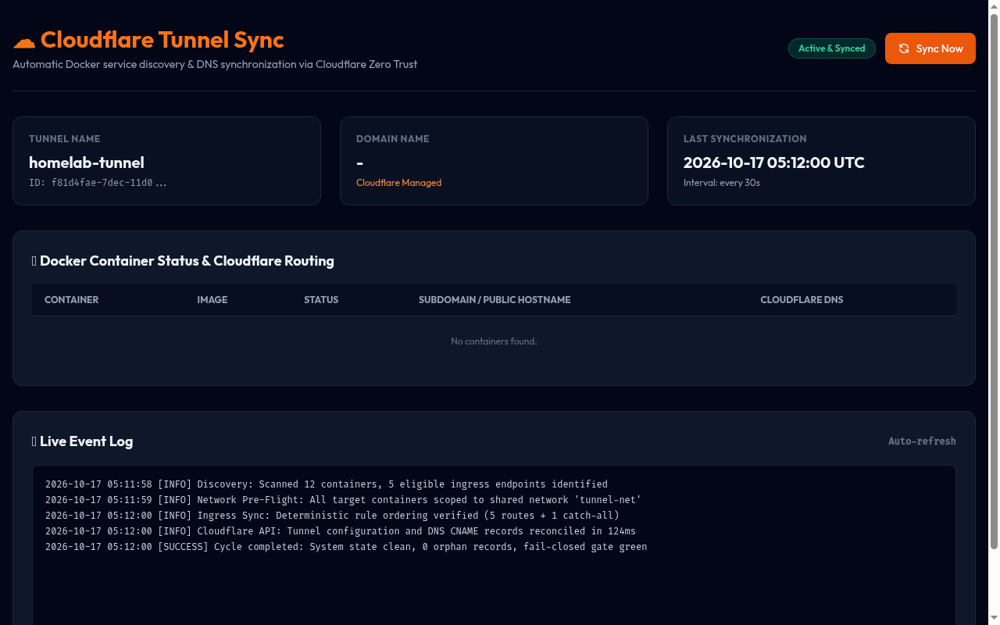
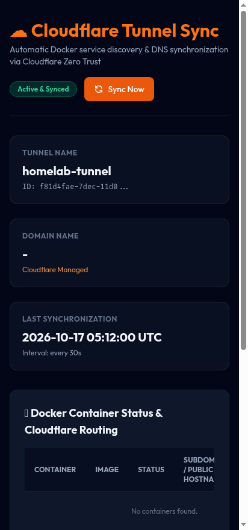

<div align="center">

# ☁️ cf-docker-tunnel-sync

**Automate Cloudflare Tunnel ingress rules and DNS CNAME records directly from Docker container labels.**

[](https://github.com/hapheus/cf-docker-tunnel-sync/releases)
[](https://hub.docker.com/r/hapheus/cf-tunnel-sync)
[](https://github.com/hapheus/cf-docker-tunnel-sync/actions)
[](https://scorecard.dev/viewer/?uri=github.com/hapheus/cf-docker-tunnel-sync)
[](LICENSE)

[Quickstart](QUICKSTART.md) · [Documentation](docs/README.md) · [Examples](examples/) · [Contributing](CONTRIBUTING.md)

</div>

---

### Why cf-docker-tunnel-sync?

Exposing Docker containers through Cloudflare usually requires manual configuration in the Cloudflare Zero Trust dashboard or static `config.yml` files, combined with manual DNS record creation.

`cf-docker-tunnel-sync` eliminates this friction:
- 🔒 **Zero Inbound Ports:** No router port forwarding (80/443) or dynamic DNS required. Traffic reaches your host securely via Cloudflare Tunnel.
- 🏷️ **Label-Driven Routing:** Add two labels (`cf.tunnel.hostname` and `cf.tunnel.port`) to any container; ingress routes and proxied DNS CNAMEs are managed automatically.
- ⚡ **Event-Driven & Instant:** Detects container startup and teardown via Docker events in real-time, with automatic debouncing and periodic reconciliation fallback.
- 🛡️ **Production Safety Guards:** Safe deletion limits, unmanaged route preservation, dry-run mode, and preflight validation prevent accidental outages.
- 📊 **Built-In Visibility:** Includes an embedded web dashboard, Prometheus metrics (`/metrics`), structured JSON logging, and webhook notifications.

---

## How It Works

The architecture separates the **control plane** from the **data plane**:

```
 ┌─────────────────────────────────────────────────────────────┐
 │ Host / Docker Engine                                        │
 │                                                             │
 │   ┌─────────────────┐  Docker API   ┌─────────────────────┐ │
 │   │ App Container   │◄──────────────┤ cf-tunnel-sync      │ │
 │   │ (cf.tunnel.*)   │               │ (Control Plane)     │ │
 │   └────────┬────────┘               └──────────┬──────────┘ │
 │            │ Internal Traffic                  │ Cloudflare │
 │            │ (cf-tunnel-net)                   │ API        │
 │   ┌────────┴────────┐                          ▼            │
 │   │ cloudflared     │◄─────────────────► Cloudflare Edge    │
 │   │ (Data Plane)    │  Encrypted Tunnel  (Ingress + DNS)    │
 │   └─────────────────┘                                       │
 └─────────────────────────────────────────────────────────────┘
```

1. **Control Plane (`cf-tunnel-sync`):** Watches Docker events. When a labeled container starts, it creates/updates the Cloudflare Tunnel ingress route and provisions the DNS CNAME record via the Cloudflare API.
2. **Data Plane (`cloudflared`):** The official Cloudflare connector carries encrypted traffic between Cloudflare's edge and your containers over a shared Docker bridge network.

---

## Quick Start (60 Seconds)

### 1. Start the Gateway

Create a minimal `docker-compose.yml` with your Cloudflare API token and domain:

```yaml
services:
  cloudflared:
    image: cloudflare/cloudflared:2025.5.0
    restart: unless-stopped
    command: tunnel --no-autoupdate run --token-file /etc/cloudflared/token
    volumes:
      - cf_token_data:/etc/cloudflared
    networks:
      - cf-tunnel-net
    depends_on:
      cf-tunnel-sync:
        condition: service_healthy

  cf-tunnel-sync:
    image: hapheus/cf-tunnel-sync:latest
    restart: unless-stopped
    environment:
      CLOUDFLARE_API_TOKEN: ${CLOUDFLARE_API_TOKEN}
      CLOUDFLARE_TUNNEL_NAME: homelab-tunnel
      DOMAIN_NAME: example.com
      CF_NETWORK_NAME: cf-tunnel-net
      DASHBOARD_ENABLED: "false"
    volumes:
      - /var/run/docker.sock:/var/run/docker.sock:ro
      - cf_token_data:/etc/cloudflared
    networks:
      - cf-tunnel-net
    healthcheck:
      test: ["CMD", "python", "healthcheck.py"]
      interval: 10s
      timeout: 5s
      retries: 3
      start_period: 5s

networks:
  cf-tunnel-net:
    name: cf-tunnel-net
    driver: bridge

volumes:
  cf_token_data:
```

Start the gateway:
```bash
docker compose up -d
```

### 2. Expose an Application

Attach any container to `cf-tunnel-net` with two labels:

```yaml
services:
  whoami:
    image: traefik/whoami:latest
    restart: unless-stopped
    networks:
      - cf-tunnel-net
    labels:
      cf.tunnel.hostname: whoami.example.com
      cf.tunnel.port: "80"

networks:
  cf-tunnel-net:
    external: true
```

Run `docker compose up -d`. `cf-tunnel-sync` detects the new container, registers the route in Cloudflare Tunnel, and creates the `whoami.example.com` CNAME record.

### 3. Verify

```bash
curl -I https://whoami.example.com
```

> [!TIP]
> For production deployments, digest pinning, and secure Docker socket proxies, see the comprehensive [QUICKSTART.md](QUICKSTART.md).

---

## When to Use (and When NOT to Use)

### ✅ Ideal For
- **Homelabs & Single-Host Setups:** Expose self-hosted web apps (Nextcloud, Home Assistant, Vaultwarden, Jellyfin) without public IP exposure or port forwarding.
- **Docker Compose Stacks:** Maintain independent Compose projects that share a single tunnel gateway via an external bridge network.
- **Automated Staging Environments:** Dynamically provision public test hostnames as feature containers spin up and down.

### ❌ Not Intended For
- **Kubernetes / Docker Swarm:** Use Cloudflare's native Kubernetes Ingress Controller or cluster operators instead.
- **Raw TCP/UDP Protocols:** Cloudflare Tunnel ingress primarily routes HTTP/HTTPS. Exposing arbitrary TCP/SSH requires client-side `cloudflared access` configurations not managed by this controller.
- **Cloudflare Access Policy Provisioning:** Labels such as `cf.tunnel.access` display metadata in the dashboard, but **do not** create Access authorization policies. Configure Cloudflare Zero Trust Access policies separately.
- **Internal LAN-Only Proxying:** This tool manages Cloudflare public edge routing, not local mDNS or internal split-horizon DNS.

---

## Deployment Examples

| Example | Purpose |
| --- | --- |
| [Single stack](examples/01-quickstart-single-stack/README.md) | Gateway, connector, and demo application running together in one Compose file. |
| [Separate stacks](examples/02-multi-stack-external-net/README.md) | Central gateway network shared across independent application Compose projects. |
| [Socket proxy](examples/03-secure-socket-proxy/README.md) | Enhanced security: isolates the Docker socket behind a read-only TCP proxy. |
| [Origin settings](examples/04-advanced-labels-tls-multiport/README.md) | HTTPS origins, custom request headers, multi-port selection, and TLS verification. |
| [Multiple gateways](examples/05-multi-account/README.md) | Multi-domain and multi-account configurations with dedicated tokens and volumes. |

---

## Dashboard

`cf-tunnel-sync` includes an embedded dashboard (port 8090 / configurable) and supports an optional standalone Nginx companion container ([`cf-tunnel-dashboard`](cf-tunnel-dashboard/DOCKERHUB.md)).

| Desktop View | Mobile View |
| --- | --- |
|  |  |

---

## Documentation Index

- **Getting Started:** [Quickstart Guide](QUICKSTART.md) · [Exposing Existing Services](docs/onboarding.md) · [Scoped API Token Setup](docs/cloudflare-permissions.md)
- **Configuration:** [Environment Variables Reference](docs/configuration.md) · [Container Label Reference](docs/labels.md) · [Docker Networking Guide](docs/networking-guide.md)
- **Operations & Security:** [Operations & Metrics](docs/operations.md) · [Troubleshooting Guide](docs/troubleshooting.md) · [Security Model](docs/security.md) · [Architecture & Safety Limits](docs/architecture-and-safety.md)
- **Reference:** [HTTP API Documentation](docs/api.md) · [Product Scope & Boundaries](docs/product-boundaries.md) · [Compatibility & Upgrades](docs/COMPATIBILITY.md)

---

## License

[MIT](LICENSE)
