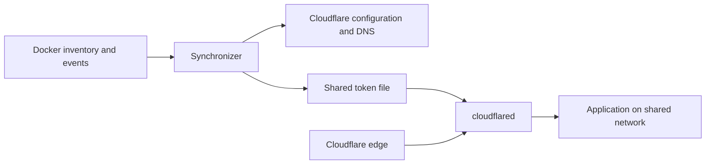

# Architecture and safety

The synchronizer is a configuration controller. Docker labels describe desired services; Cloudflare stores the remote tunnel configuration and DNS. The separate `cloudflared` connector carries application traffic.



## A synchronization cycle

1. Discover Docker services and stop if the inventory is unavailable or degraded.
2. Resolve the Cloudflare zone and account, then look up the named tunnel.
3. In live mode, provision a missing tunnel, obtain its real ID, update the connector token when needed, and attempt a restart. Dry-run reports a missing tunnel as a prerequisite and performs no external writes.
4. Read tunnel ingress and relevant CNAME records from Cloudflare.
5. Compute a plan from explicit snapshots, policies, time, and plan identity.
6. Apply deletion limits and execute ingress/DNS changes in live mode.
7. Publish copied status, diagnostics, metrics, history, and alerts.

Docker events trigger synchronization after a default 2.5-second debounce window, capped at 10 seconds. The fallback interval is 900 seconds. An initial cycle runs at startup. Concurrent sync requests are skipped while a cycle is in progress.

The service has no local database. Tombstones, history, and caches are in memory and reset on restart; the token file persists in the shared volume. Remote configuration survives stopping the synchronizer. See [operations](operations.md) for recovery and removal.

## DNS ownership

New CNAME records target `<tunnel-id>.cfargotunnel.com` and carry the comment:

```text
cf-tunnel-sync:<tunnel-name>
```

The ownership classifier compares the record type, target, comment, and whether an active local service requests the hostname.

| Classification | Meaning | Normal treatment |
| --- | --- | --- |
| Owned | CNAME target and ownership comment match | Manage and clean up after the grace period. |
| Adopted | CNAME points to this tunnel, has no ownership tag, and is requested locally | Default policy adds the tag; `strict_tagged_only` protects it from adoption. |
| Unmanaged | Untagged CNAME points to this tunnel but is not requested locally | Preserve under the default policy. |
| Foreign tunnel | Matching target has a different synchronizer ownership tag | Protect. |
| Unrelated | Type or target does not match | Protect. |

`legacy_unrestricted` relaxes cleanup rules for old deployments. Prefer the default policy or `strict_tagged_only`; see [configuration](configuration.md).

## Grace periods and deletion limits

When a managed service disappears, its hostname enters a tombstone grace period (300 seconds by default). Ingress and DNS remain during that period. If the service returns, the tombstone is cleared. If it stays absent, a later sync can remove its managed route and DNS record.

After a sudden drop from at least two discovered services to zero, the current cycle disables immediate cleanup and uses at least a 300-second grace period. This is different from a complete ban on cleanup for every successful empty Docker response.

`MAX_DELETIONS_PER_SYNC` defaults to three. The execution guard counts the larger of ingress and DNS deletion counts rather than adding them. An optional ratio guard is available. Exceeding a limit aborts execution; `ALLOW_MASS_DELETIONS=true` overrides execution limits. See the [configuration reference](configuration.md) for precedence and defaults.

## Docker failures

Discovery errors mark Docker as degraded and stop the normal ingress/DNS pipeline. The planner also preserves remote resources when its discovery snapshot is degraded. Discovery is checked before provisioning or connector activation. A successful empty inventory is usable and remains distinct from an outage. An outage after discovery can still cause a later operation to fail; synchronization is not an atomic transaction.

## Current limitations

Use a dedicated tunnel and inspect existing configuration before enabling synchronization. The current implementation has these relevant limits:

- **Root-route collisions need review.** The synchronizer manages the first root route for an active discovered hostname. Existing path routes, other duplicate routes, unknown fields, and catch-alls keep their relative order. New roots are inserted before the first hostname-less fallback. A preserved path rule can intentionally take precedence over a managed root.
- **Updates are not transactional.** Ingress failure does not prevent DNS execution. Partial failure is reported as degraded and retried from freshly fetched state; there is no rollback. Expired tombstones remain through failed execution so retries do not restart the grace period.
- **Dry-run cannot provision prerequisites.** A missing tunnel is reported without creating a speculative ingress/DNS plan. Preview endpoints can still show local estimates using placeholder IDs; these are never sent to Cloudflare.
- **Token activation is best effort.** Token-file or restart failures are logged. After a successful token write followed by a failed restart, the next unchanged-token cycle does not automatically repeat the restart; inspect connector logs and restart it manually when needed.
- **Shutdown has a timeout.** Scheduling stops, pending debounce work is cancelled, and the event stream is closed. The scheduler waits for in-flight sync work; it reports a timeout if work cannot finish. Python cannot forcibly stop an arbitrary blocked worker thread.
- **Access labels are metadata.** They do not create an Access application, identity checks, or an authentication policy.

These are current behavior descriptions, not promises about future fixes. See [security](security.md) for exposure boundaries and [troubleshooting](troubleshooting.md) for checks.

## Python component boundaries

Production code lives in the installed `src/tunnel_sync` package. `tunnel_sync.web.app.create_app()` builds applications using `tunnel_sync.bootstrap.create_services()`. Each composition owns its settings snapshot, runtime state, metrics, notifications, and scheduler.

```text
src/
  tunnel_sync/
    configuration/       # environment snapshots and validation
    domain/              # pure models, labels, diagnostics, and planning
    application/         # discovery, synchronization, execution, and state
    adapters/            # Docker, Cloudflare, notifications, metrics, and retries
    runtime/             # CLI, health probe, scheduling, and logging
    web/                 # HTTP routes, auth, response models, and static assets
    compat/              # historical Python helper implementations
    bootstrap.py         # dependency wiring
    security.py          # shared pure credential redaction
  app.py, ...            # small aliases preserving historical imports
tests/
  unit/                  # domain, configuration, adapter, application, and web tests
  integration/           # complete sync cycles and lifecycle with local fakes
  contracts/             # API/configuration/upgrade and example contracts
  architecture/          # dependency direction and import side effects
  property/              # generated-input and state-machine tests
  docs/                  # links, assets, and dashboard DOM checks
  fixtures/              # versioned compatibility data
scripts/                 # development tools, including the fuzz harness
cf-tunnel-sync/           # stable Docker build files and legacy script entry points
cf-tunnel-dashboard/      # optional companion dashboard
docs/                    # operator documentation and architecture explanations
examples/                # complete deployment examples
```

New implementation belongs in the package, with tests in the corresponding test area. Compatibility modules delegate to it and do not contain a second synchronization engine. The regular CLI is `cf-docker-tunnel-sync` or `python -m tunnel_sync`; `python cf-tunnel-sync/app.py` and the ASGI import `app:app` remain supported. The CLI does not depend on the compatibility helpers.

| Component | Responsibility |
| --- | --- |
| `configuration` | Explicit settings snapshots, supported-variable metadata, and startup validation. |
| `domain` | Typed reconciliation values, observed label precedence, ingress merging, and deterministic planning; no I/O or environment reads. |
| `application` | Discovery, read-only previews/preflight, sync coordination, deletion policy, the sole mutation executor, and status publication. |
| `adapters` | Docker Unix/TCP transport, Cloudflare HTTP/retries/pagination, token storage, connector restart, notification delivery, and Prometheus formatting. |
| `runtime` | Debounce, periodic/event scheduling, logging setup, and shutdown ownership. |
| `web` | HTTP authentication, response serialization, and routes calling application services. |

The planner receives time and plan identity as inputs and copies mutable snapshots. Its result can be compared without starting a web server or touching a provider. Reader and writer capabilities are separate; previews and preflight receive no Cloudflare writer or connector restarter. Both historical execution helpers and live sync delegate to one executor; the historical helper retains fail-fast errors, while live sync collects partial failures.

Working state and published snapshots use separate locks. Status endpoints read detached snapshots without waiting for provider I/O. The scheduler keeps sync work off the event loop and owns the listener thread and scheduled tasks. See [contributing](../CONTRIBUTING.md) for isolated test and package checks.
