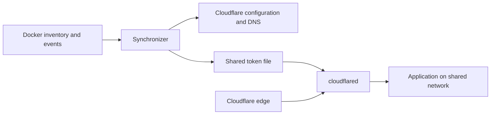

# Architecture and safety

The synchronizer is a configuration controller. Docker labels describe desired services; Cloudflare stores the remote tunnel configuration and DNS. The separate `cloudflared` connector carries application traffic.



## A synchronization cycle

1. Resolve the Cloudflare zone and account, then find or create the named tunnel.
2. Retrieve the connector token, update `/etc/cloudflared/token` if needed, and attempt a connector restart.
3. Discover running services from Docker labels and evaluate their network configuration.
4. Read tunnel ingress and relevant CNAME records from Cloudflare.
5. Compute the desired ingress/DNS changes and grace-period transitions.
6. Apply deletion limits and execute ingress/DNS changes, unless dry-run is active.
7. Update status, diagnostics, metrics, history, and alerts.

Docker events trigger synchronization after a default 2.5-second debounce window, capped at 10 seconds. The fallback interval is 900 seconds. An initial cycle runs at startup. Concurrent sync requests are skipped while a cycle is in progress.

The service has no local database. Tombstones, history, and caches are in memory and reset on restart; the token file persists in the shared volume. Remote configuration survives stopping the synchronizer. See [operations](operations.md) for recovery and removal.

## DNS ownership

New CNAME records target `<tunnel-id>.cfargotunnel.com` and carry the comment:

```text
cf-tunnel-sync:<tunnel-name>
```

The ownership classifier compares the record type, target, comment, and whether an active local service requests the hostname.

| Classification | Meaning | Normal treatment |
| --- | --- | --- |
| Owned | CNAME target and ownership comment match | Manage and clean up after the grace period. |
| Adopted | CNAME points to this tunnel, has no ownership tag, and is requested locally | Default policy adds the tag; `strict_tagged_only` protects it from adoption. |
| Unmanaged | Untagged CNAME points to this tunnel but is not requested locally | Preserve under the default policy. |
| Foreign tunnel | Matching target has a different synchronizer ownership tag | Protect. |
| Unrelated | Type or target does not match | Protect. |

`legacy_unrestricted` relaxes cleanup rules for old deployments. Prefer the default policy or `strict_tagged_only`; see [configuration](configuration.md).

## Grace periods and deletion limits

When a managed service disappears, its hostname enters a tombstone grace period (300 seconds by default). Ingress and DNS remain during that period. If the service returns, the tombstone is cleared. If it stays absent, a later sync can remove its managed route and DNS record.

After a sudden drop from at least two discovered services to zero, the current cycle disables immediate cleanup and uses at least a 300-second grace period. This is different from a complete ban on cleanup for every successful empty Docker response.

`MAX_DELETIONS_PER_SYNC` defaults to three. The execution guard counts the larger of ingress and DNS deletion counts rather than adding them. An optional ratio guard is available. Exceeding a limit aborts execution; `ALLOW_MASS_DELETIONS=true` overrides execution limits. See the [configuration reference](configuration.md) for precedence and defaults.

## Docker failures

Discovery errors mark Docker as degraded and stop the normal ingress/DNS pipeline. The planner also preserves remote resources when its discovery snapshot is degraded. However, tunnel initialization happens before discovery, and a successful empty inventory is not automatically treated as an outage. Do not interpret this behavior as a guarantee of zero writes for every Docker failure scenario.

## Current limitations

Use a dedicated tunnel and inspect existing configuration before enabling synchronization. The current implementation has these relevant limits:

- **Dry-run starts after initialization.** `DRY_RUN=true` skips planned ingress/DNS writes, but a missing tunnel may still be created, the token file written, and the connector restarted. The CLI flag has the same boundary. Use `--preflight` for non-mutating inspection; it still reads configured services.
- **Missing ownership fields are not fully protected.** A CNAME response without the `comment` key is treated as owned when its target matches. This differs from an explicit empty/null comment and can make an untagged record eligible for cleanup. `strict_tagged_only` does not correct this classifier behavior.
- **Manual ingress rules are not preserved losslessly.** Rules are indexed by hostname and the output is sorted by hostname. Multiple paths on one hostname can collapse into one rule, rule order can change, and special catch-all rules can be replaced by the final `http_status:404`. A rule sharing an active hostname may also be replaced. Do not attach a tunnel with complex manual routing without reviewing this limitation.
- **Updates are not transactional.** Ingress failure does not prevent all DNS execution. A partial failure is reported as degraded and retried in later cycles; there is no atomic rollback.
- **An in-memory ingress cache influences writes.** A fresh process can write configuration even when the planner reports no ingress change; later remote-only ingress drift may be missed if the cached desired configuration stays the same. Do not assume every unchanged cycle produces zero writes or that all drift is corrected immediately.
- **Access labels are metadata.** They do not create an Access application, identity checks, or an authentication policy.

These are current behavior descriptions, not promises about future fixes. See [security](security.md) for exposure boundaries and [troubleshooting](troubleshooting.md) for checks.
