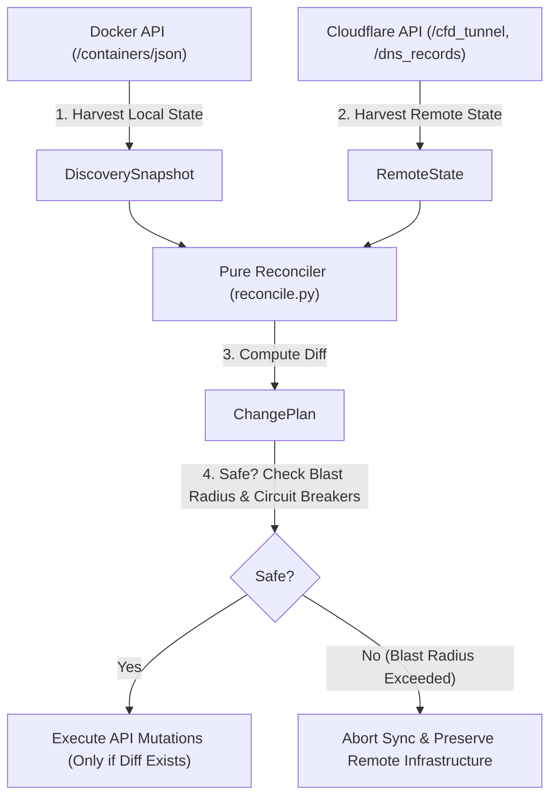

# Architecture, Safety & DNS Ownership Deep-Dive

This document details the internal design, reconciliation state machine, DNS ownership mechanics, and fail-safe circuit breakers of `cf-docker-tunnel-sync`.

---

## 1. The Controller Pattern (Zero-Local-State)

`cf-docker-tunnel-sync` is modeled after Kubernetes controllers:
* **Stateless Operation:** There is no local database (no SQLite, no state JSON) that could become desynchronized or corrupt.
* **Single Source of Truth:**
  - Desired State is read live from Docker container labels (`/containers/json`).
  - Remote State is read live from Cloudflare (`/accounts/.../cfd_tunnel/.../configurations` and `/zones/.../dns_records`).
* **Self-Healing Reconciliation Loop:**
  - Evaluates every 30 seconds (fallback polling) or instantaneously upon Docker lifecycle events with a 2.5-second debounce window.
  - Automatically recovers from transient Cloudflare API outages or network disruptions during the very next cycle without requiring container restarts.



---

## 2. Sync Run Lifecycle (Step-by-Step)

Each reconcile cycle executes through 6 deterministic phases:

1. **Docker Engine Harvest:** Queries Docker via the local Unix socket or TCP socket proxy (`DOCKER_HOST`).
2. **Container Label Filtering:** Identifies containers with `cf.tunnel.enable=true` (or legacy alias `cloudflared.enable=true`).
3. **Fail-Safe Label Validation:** Invalid or malformed labels on one container are flagged as degraded and isolated; they **never crash the daemon** or affect other containers.
4. **ChangePlan Computation & Diff-Check:**
   - Compares the desired ingress rules against the existing Cloudflare Tunnel configuration.
   - Compares the desired DNS CNAMEs against existing Cloudflare DNS records.
   - If no changes are needed, **zero Cloudflare API mutation calls are made**, completely avoiding API rate limits.
5. **DNS Ownership Verification & Mutations:**
   - Evaluates record ownership before any deletion or update.
   - Only mutates or creates records when required.
6. **Mandatory Catch-All Ingress Rule:**
   - Ensures the terminal Cloudflare Ingress rule (`service: http_status:404`) is always placed at the end of the rule list.

---

## 3. DNS Ownership & Safe Cleanup Model

A primary fear of DevOps engineers adopting DNS-sync tools is accidental deletion of existing DNS entries. `cf-docker-tunnel-sync` eliminates this risk via explicit **Ownership Tagging**:

### 3.1 Cloudflare Record Tagging
Every DNS record created or managed by `cf-tunnel-sync` is stamped with an immutable metadata tag in Cloudflare's `comment` attribute:
```text
comment: "cf-tunnel-sync:<tunnel_name>"
```

### 3.2 Strict Ownership Classifications

| Classification | Condition | Permitted Operations |
| :--- | :--- | :--- |
| **`OWNED`** | Matches tunnel target AND has `cf-tunnel-sync:<tunnel_name>` tag. | **Create, Update, Safe Delete** |
| **`ADOPTED`** | Matches tunnel target but has no tag; currently active container requests it. | **Adopt with Tag** (`adopt_and_manage` policy) |
| **`UNMANAGED`** | Matches tunnel target but has no tag; no active container requests it. | **READ-ONLY — NEVER DELETED** |
| **`FOREIGN_TUNNEL`** | Points to another tunnel or has a different tunnel tag prefix. | **READ-ONLY — NEVER TOUCHED** |
| **`UNRELATED`** | Type is A, AAAA, MX, TXT, or CNAME to another domain. | **READ-ONLY — NEVER TOUCHED** |

> [!IMPORTANT]
> Manually configured DNS records (A, AAAA, MX, TXT, or unmanaged CNAMEs) will **never be modified or deleted** by `cf-docker-tunnel-sync`.

---

## 4. Container Restart Flapping Protection (Tombstoning)

When a container stops during an image update (`docker compose up -d`) or host reboot:
1. `cf-tunnel-sync` detects that the container is temporarily offline.
2. Rather than immediately deleting the Cloudflare Ingress rule and DNS record, it enters a **tombstone grace period** (`DNS_CLEANUP_GRACE_PERIOD=300`, 5 minutes default).
3. If the container restarts within 5 minutes, the tombstone is cleared with **zero Cloudflare API writes**, preventing DNS cache flapping and `NXDOMAIN` browser caching.
4. Only if the container remains absent after 5 minutes is the DNS record safely deleted.

---

## 5. Fail-Closed Circuit Breakers & Blast-Radius Protection

### 5.1 Empty-Inventory Circuit Breaker
If the Docker daemon restarts or returns 0 containers due to an engine glitch, `cf-tunnel-sync` recognizes the sudden inventory drop, aborts the cycle, and refuses to delete any Cloudflare records.

### 5.2 Blast-Radius Deletion Threshold
* `MAX_DELETIONS_PER_SYNC=3`: If any synchronization cycle attempts to delete more than 3 routes/DNS records simultaneously, the blast-radius circuit breaker trips immediately.
* Sync is halted, existing Cloudflare routes remain intact, and a protective alert is logged:
  ```text
  [WARNING] Blast-radius protection tripped: 5 planned deletions exceeds threshold 3. Sync aborted. Set ALLOW_MASS_DELETIONS=true to override.
  ```
