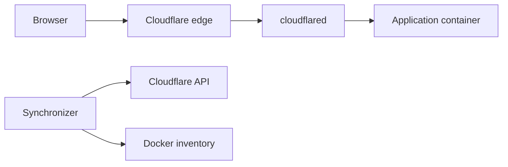

# Docker networking and traffic flow

`cloudflared` must be able to reach the application's internal address and port. The synchronizer only configures routing; it does not proxy requests.

## Request path



For a typical HTTP application, the ingress target is `http://<container-name>:<port>`. Docker resolves the name on a shared network. The application must listen on a reachable container interface, usually `0.0.0.0`, rather than only on its own loopback interface.

Host port publication is not needed for this path. A published host port and the application's internal listening port are different settings.

## One Compose stack

Put the connector and application on the same network. The synchronizer also joins the gateway network in the supplied examples. See the [single-stack example](../examples/01-quickstart-single-stack/README.md).

## Separate Compose stacks

Start a gateway stack that creates the named network. Application stacks refer to it as external:

```yaml
services:
  web:
    image: nginx:alpine
    networks:
      - default
      - cf-tunnel-net
    labels:
      cf.tunnel.hostname: web.example.com
      cf.tunnel.port: "80"

networks:
  cf-tunnel-net:
    external: true
```

Alternatively, create the network yourself before starting stacks that all declare it external:

```bash
docker network create cf-tunnel-net
```

Choose one network-creation approach. See the [separate-stack walkthrough](../examples/02-multi-stack-external-net/README.md) for complete files.

## Discovery and diagnostics

The normal constructed target uses the container name; `cf.tunnel.service` can override the URL. The network plausibility check evaluates the target and known connector networks, but it is not an active HTTP or TLS reachability probe.

`CF_NETWORK_NAME` defaults to `cf-tunnel-net`. Connector selection also examines configuration and candidate containers. Set `CLOUDFLARED_CONTAINER_NAME` when selection is ambiguous. `REQUIRE_SHARED_NETWORK=true` or `STRICT_NETWORK_CHECK=true` excludes origins that fail the plausibility check; otherwise they can remain configured with a warning.

For unusual topologies, an explicit origin URL must be reachable **from the connector**. A successful host-side request does not prove that route works inside the connector's network.

## Unreachable services

For a tunnel-origin 502, compare the configured URL with the application's actual protocol, listening port, network, and TLS certificate. For 1033, check the connector's connection to Cloudflare first. The [troubleshooting guide](troubleshooting.md) separates these checks and links to Cloudflare's error reference.
