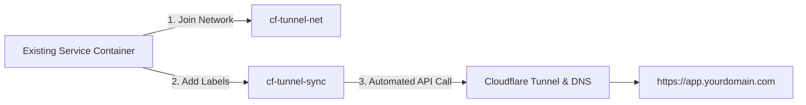

# Onboarding Existing Services in <10 Minutes

This guide walks you through exposing an existing Dockerized service (such as Nextcloud, Grafana, Home Assistant, Gitea, or a custom web app) through your Cloudflare Tunnel gateway in **under 10 minutes**, with zero port-forwarding on your router and zero firewall pinholes.

---

## The 3-Step Recipe

Exposing any existing Docker service requires exactly three actions:
1. Connect the service to the gateway network (`cf-tunnel-net`).
2. Add two labels to the service.
3. Restart the service container.



---

## Step-by-Step Walkthrough

### Step 1: Attach Your Service to `cf-tunnel-net`

In your existing service's `docker-compose.yml`, define the external network and attach your service to it:

```yaml
services:
  my-app:
    image: my-existing-image:latest
    restart: unless-stopped
    networks:
      - default
      - cf-tunnel-net # <--- Attach to gateway network
    labels:
      - "cf.tunnel.enable=true"
      - "cf.tunnel.hostname=app.yourdomain.com"

networks:
  cf-tunnel-net:
    external: true # <--- References the network created by cf-docker-tunnel-sync
```

> [!TIP]
> Notice that you **do not** need to expose any ports on the host machine (no `ports: "8080:80"` mapping). Traffic routes internally across the private Docker bridge network directly into Cloudflare's tunnel connector.

### Step 2: Apply the Two Golden Labels

Add the two essential labels:
- `cf.tunnel.enable=true` — Signals to `cf-tunnel-sync` to manage this container.
- `cf.tunnel.hostname=app.yourdomain.com` — Defines the public HTTPS hostname.

#### What if the container exposes multiple internal ports?
If your image exposes multiple ports (e.g. `80` and `443` or `8080` and `9000`), specify which port to route to:
```yaml
labels:
  - "cf.tunnel.enable=true"
  - "cf.tunnel.hostname=app.yourdomain.com"
  - "cf.tunnel.port=8080" # Explicit internal port
```

### Step 3: Deploy & Verify

Recreate your container:
```bash
docker compose up -d
```

`cf-tunnel-sync` detects the Docker event, provisions the ingress rule, and creates the proxied CNAME record in Cloudflare DNS within seconds.

Verify via curl:
```bash
curl -I https://app.yourdomain.com
```

---

## Novice Friction Points & Solutions

Usability testing across first-time Docker users identified recurring questions and friction points. Here are the immediate answers:

### 1. "Do I still need `ports: 8080:80` in my compose file?"
**No.** Host port publishing is completely unnecessary and opens an unauthenticated doorway on your host. Remove the `ports:` block entirely unless you need direct LAN access.

### 2. "Why does `docker compose up` fail with `network cf-tunnel-net not found`?"
The gateway network must exist before child stacks can attach to it as `external: true`. Ensure you started your gateway stack first (`docker compose up -d` in your gateway directory), or create the network manually once:
```bash
docker network create cf-tunnel-net
```

### 3. "My service uses HTTPS internally (self-signed cert). How do I avoid TLS errors?"
If your container originates an HTTPS service (like Proxmox, TrueNAS, or Unifi Controller) with a self-signed TLS certificate, tell Cloudflare to skip origin verification:
```yaml
labels:
  - "cf.tunnel.enable=true"
  - "cf.tunnel.hostname=router.yourdomain.com"
  - "cf.tunnel.port=8443"
  - "cf.tunnel.originRequest.noTLSVerify=true"
```

### 4. "How do I secure an internal admin dashboard with Cloudflare Zero Trust?"
Tag your service with an Access policy tag:
```yaml
labels:
  - "cf.tunnel.enable=true"
  - "cf.tunnel.hostname=admin.yourdomain.com"
  - "cf.tunnel.access.policy=internal-team-only"
```

---

## 5-Minute Checklist for Successful Onboarding

| Verification | Command / Check | Expected Result |
| :--- | :--- | :--- |
| Network attached | `docker inspect <container> --format '{{json .NetworkSettings.Networks}}'` | Contains `"cf-tunnel-net"` |
| Labels detected | `docker compose logs -f cf-tunnel-sync` | `Plan: 1 to add, 0 to update, 0 to delete` |
| Cloudflare sync | `docker compose logs -f cf-tunnel-sync` | `State reconciled successfully` |
| Public reachability | `curl -s -o /dev/null -w "%{http_code}" https://app.yourdomain.com` | `200` (or `302`/`401` if auth protected) |
