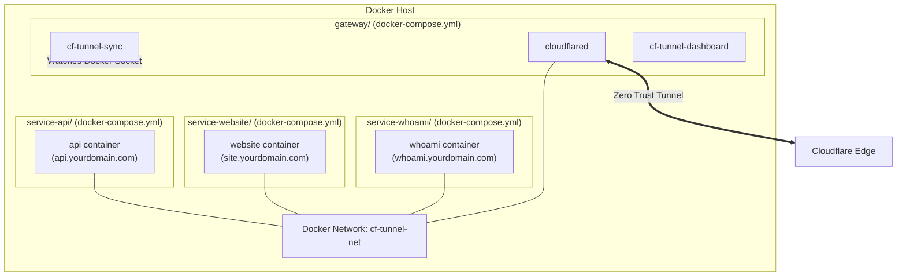

# Example 02: Multi-Compose Architecture (Central Gateway Pattern)

This is the **recommended production pattern** for running multiple microservices or containers on a single Docker host.

Instead of running a separate Cloudflare tunnel inside every single `docker-compose.yml`, you run **one central gateway stack**. All other applications run in their own independent `docker-compose.yml` files and join the shared Docker network `cf-tunnel-net`.

---

## 🏛️ Architecture Overview



---

## 📁 Directory Structure

- **`gateway/`**: The core tunnel and sync stack. Starts `cloudflared`, `cf-tunnel-sync`, and creates the bridge network `cf-tunnel-net`.
- **`service-whoami/`**: A lightweight debugging service (`whoami.yourdomain.com`).
- **`service-website/`**: A static web server / landing page (`site.yourdomain.com`).
- **`service-api/`**: An HTTP API service (`api.yourdomain.com`).

---

## 🚀 How to Run

### Step 1: Start the Central Gateway
```bash
cd gateway
cp .env.example .env
# Edit .env with your DOMAIN_NAME and CLOUDFLARE_API_TOKEN
docker compose up -d
```
The gateway initializes the tunnel and creates the `cf-tunnel-net` network.

### Step 2: Start any Service in its Own Directory
```bash
# Start Service 1
cd ../service-whoami
cp .env.example .env # Set DOMAIN_NAME
docker compose up -d

# Start Service 2
cd ../service-website
cp .env.example .env # Set DOMAIN_NAME
docker compose up -d

# Start Service 3
cd ../service-api
cp .env.example .env # Set DOMAIN_NAME
docker compose up -d
```

Within 30 seconds, `cf-tunnel-sync` detects the running containers, registers their hostnames with Cloudflare Tunnel, and provisions public HTTPS CNAME records for each service.
