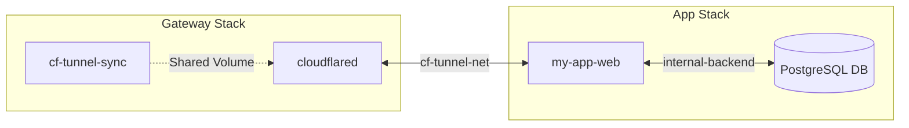

# 🌐 Example 02: Real-World Multi-Stack with External Network

In realistic production and homelab setups, services are decoupled into independent Compose stacks rather than combined into a single monolithic file.

This example shows how to deploy a dedicated **Core Gateway Stack** and connect an **Application Stack** via a shared external Docker network (`cf-tunnel-net`).

---

## Why This Architecture Prevents 502 Bad Gateway Errors

A Cloudflare Tunnel error `HTTP 502 Bad Gateway` almost always means `cloudflared` cannot reach the origin container's IP/port across Docker's bridge networks.

By creating an external bridge network (`cf-tunnel-net`) and attaching both `cloudflared` and your application container to it:
1. `cloudflared` resolves container hostnames (e.g., `http://my-app-web:80`) using Docker's internal embedded DNS.
2. Backends (like internal databases) stay safely isolated on their own internal networks without exposure to `cloudflared`.



---

## Step-by-Step Deployment

### Step 1: Create the External Bridge Network (One-Time Setup)
```bash
docker network create cf-tunnel-net
```

### Step 2: Start the Core Gateway Stack
```bash
cd core-tunnel-stack
cp .env.example .env
# Edit .env with your Cloudflare API Token and domain
docker compose up -d
```

### Step 3: Start the Application Stack
```bash
cd ../app-stack-example
cp .env.example .env
# Edit .env with your domain
docker compose up -d
```

`cf-tunnel-sync` instantly notices the new container, computes the ChangePlan, registers the ingress route with Cloudflare, and creates `app.example.com` in DNS.
