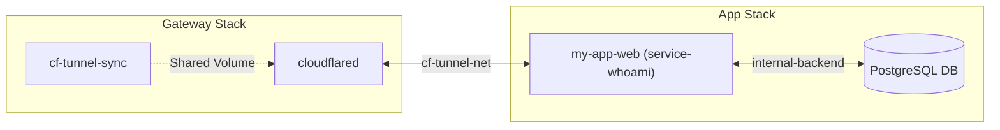

# 🌐 Example 02: Real-World Multi-Stack with External Network

In realistic production and homelab setups, services are decoupled into independent Compose stacks rather than combined into a single monolithic file.

This example shows how to deploy a dedicated **Core Gateway Stack** and connect an **Application Stack** (such as `service-whoami` or custom web apps) via a shared external Docker network (`cf-tunnel-net`).

---

## 🏗️ Why This Architecture Prevents 502 Bad Gateway Errors

A Cloudflare Tunnel error `HTTP 502 Bad Gateway` almost always means `cloudflared` cannot reach the origin container's IP/port across Docker's bridge networks.

By creating an external bridge network (`cf-tunnel-net`) and attaching both `cloudflared` and your application container to it:
1. `cloudflared` resolves container hostnames (e.g., `http://my-app-web:80`) using Docker's internal embedded DNS.
2. Backends (like internal databases) stay safely isolated on their own internal networks without exposure to `cloudflared`.



---

## 📁 Directory Structure

```text
examples/02-multi-stack-external-net/
├── README.md                          # Flagship walkthrough (this guide)
├── core-tunnel-stack/                 # Central tunnel gateway stack
│   ├── .env.example
│   ├── docker-compose.yml             # Canonical headless gateway (zero host ports)
│   ├── docker-compose.headless.yml    # Headless gateway variant
│   └── docker-compose.with-dashboard.yml # Gateway with optional Web Dashboard
└── app-stack-example/                 # Sample application stack (web service-whoami + isolated DB)
    ├── .env.example
    └── docker-compose.yml
```

---

## 🚀 Step-by-Step Deployment

### Step 1: Create the External Bridge Network (One-Time Setup)

```bash
docker network create cf-tunnel-net
```

### Step 2: Validate Prerequisites with Preflight Check

Verify API credentials and Docker network connectivity before deploying:

```bash
docker run --rm \
  -e CLOUDFLARE_API_TOKEN="your-token" \
  -e DOMAIN_NAME="example.com" \
  hapheus/cf-tunnel-sync:latest --preflight
```

### Step 3: Start the Core Gateway Stack

Navigate to the `core-tunnel-stack/` directory:

```bash
cd core-tunnel-stack
cp .env.example .env
# Edit .env with your Cloudflare API Token and domain
docker compose -f docker-compose.yml up -d
```

> **Headless Mode:** For complete zero-host-port security, use `docker-compose.headless.yml`:
> ```bash
> docker compose -f docker-compose.headless.yml up -d
> ```

### Step 4: Start the Application Stack (`service-whoami` Demo)

Navigate to the `app-stack-example/` directory:

```bash
cd ../app-stack-example
cp .env.example .env
# Edit .env with your domain
docker compose up -d
```

`cf-tunnel-sync` instantly detects the new container, computes the ChangePlan, registers the ingress route with Cloudflare, and provisions `app.example.com` in Cloudflare DNS.

---

## 🔍 Verification

Verify public HTTPS resolution through Cloudflare edge:

```bash
curl -I https://app.example.com
```

Expected response includes `HTTP/2 200` with the `cf-ray` header.

---

## 🧹 Teardown

To stop the stacks cleanly:

```bash
# Stop application stack
cd app-stack-example
docker compose down

# Stop core gateway stack
cd ../core-tunnel-stack
docker compose down
```
